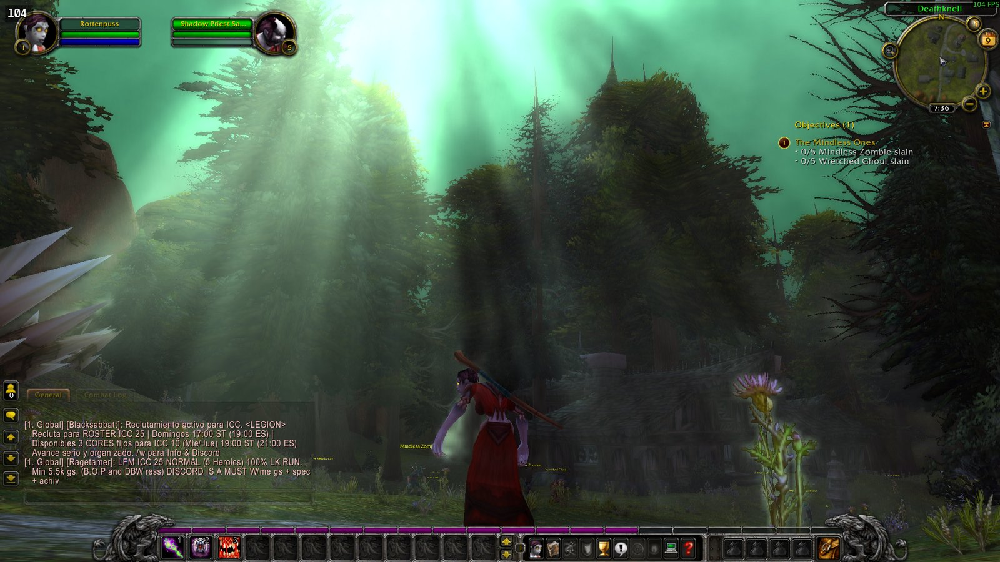
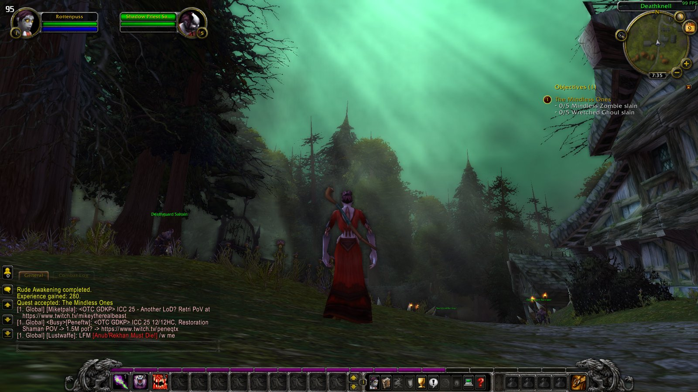
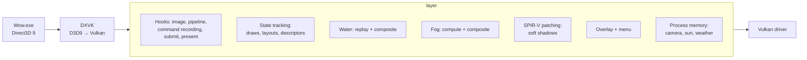

# WoW Vulkan Probe

An explicit Vulkan layer (`VK_LAYER_depth_probe`) that adds modern rendering effects to **World of Warcraft 3.3.5a** running on Linux under Proton + DXVK.

<a href="docs/images/gallery/24-deathknell-forest-sun-rays.jpg"></a>

The layer never touches the game, the Wine prefix or DXVK, and installs no DLLs. It sits between DXVK and the Vulkan driver, finds the scene's color, depth, camera and lighting on its own, and then adds:

- rewritten **water**: reflections, waves, Fresnel, sun glints, absorption, refraction, caustics and foam;
- **volumetric fog and light shafts**;
- **soft shadows**, ambient occlusion and contact shadows;
- a **graphics inspector**: click anywhere on screen to see which draw, shader and texture produced that pixel.

Every setting lives in the in-game **F10** menu and takes effect immediately.

> The project was previously called *Vulkan Depth Probe*; internal identifiers (`VK_LAYER_depth_probe`, `DEPTH_PROBE_*`, `~/.config/vulkan-depth-probe/`) still use that name.

## Contents

- [Gallery](#gallery)
- [Features](#features)
- [Building](#building)
- [Running in WoW](#running-in-wow)
- [Hotkeys](#hotkeys)
- [Menus (F10)](#menus-f10)
- [Architecture](#architecture)
- [Techniques](#techniques)
- [Settings files](#settings-files)
- [Environment variables](#environment-variables)
- [Tools](#tools)
- [Tests](#tests)
- [Repository layout](#repository-layout)
- [Documentation](#documentation)
- [Known limitations](#known-limitations)

## Gallery

All screenshots come from the real game with the default "everything on" settings. Click an image for full size.

### Light and fog

<table>
<tr>
<td width="50%"><a href="docs/images/gallery/23-deathknell-green-light-shafts.jpg"></a><br><sub><b>Deathknell, Tirisfal Glades.</b> Tirisfal's green sky light carried into the fog; shafts fall between the pines onto the village.</sub></td>
<td width="50%"><a href="docs/images/gallery/01-durotar-sunset-glare-rays.jpg"></a><br><sub><b>Valley of Trials, sunset.</b> Volumetric fog, sun glare and rays streaming from the sun disc.</sub></td>
</tr>
<tr>
<td><a href="docs/images/gallery/03-durotar-sun-rays-tree.jpg"></a><br><sub><b>Sun behind a tree.</b> Rays filtering through the leaves, plus the aureole around the disc.</sub></td>
<td><a href="docs/images/gallery/18-durotar-rays-through-tree.jpg"></a><br><sub><b>Screen-space rays.</b> A ray mask marched toward the disc on screen: shafts only pass through the gaps.</sub></td>
</tr>
<tr>
<td><a href="docs/images/gallery/06-booty-bay-ship-sun-glare.jpg"></a><br><sub><b>Facing the sun.</b> Glare and forward scattering (Henyey–Greenstein) fill the fog with light; auto exposure keeps the screen from blowing out.</sub></td>
<td><a href="docs/images/gallery/16-mulgore-sun-glare-totem.jpg"></a><br><sub><b>Camp Narache.</b> A totem in front of the sun disc: glare scales with the visible part of the disc, light spills around the edges.</sub></td>
</tr>
<tr>
<td><a href="docs/images/gallery/10-booty-bay-town-light-shafts.jpg"></a><br><sub><b>Above Booty Bay.</b> Sun shafts falling into the fog between buildings, from the sun map and a per-froxel shadow march.</sub></td>
<td><a href="docs/images/gallery/11-booty-bay-pink-morning-haze.jpg"></a><br><sub><b>Pink morning haze.</b> The fog's ambient color is read from the game's own light block (zone and time of day).</sub></td>
</tr>
<tr>
<td><a href="docs/images/gallery/12-shadowglen-violet-fog.jpg"></a><br><sub><b>Shadowglen.</b> Teldrassil's violet light flows into the fog, giving depth between the tree trunks.</sub></td>
<td><a href="docs/images/gallery/14-teldrassil-pond-haze.jpg"></a><br><sub><b>Aldrassil pond, another angle.</b> Temporal reprojection keeps the fog from flickering while the camera turns.</sub></td>
</tr>
<tr>
<td><a href="docs/images/gallery/15-mulgore-misty-morning.jpg"></a><br><sub><b>Mulgore, Red Cloud Mesa.</b> Misty morning: totems fade with distance, the grass sits in soft shadow.</sub></td>
<td><a href="docs/images/gallery/17-durotar-morning-haze.jpg"></a><br><sub><b>Durotar, morning.</b> Light height fog; distant cliffs blend into the color of the open sky.</sub></td>
</tr>
</table>

### Water

<table>
<tr>
<td width="50%"><a href="docs/images/gallery/04-booty-bay-dock-sunset-water.jpg"></a><br><sub><b>Booty Bay docks.</b> MODERN water: sky and cliff reflections, a sun path broken up by the waves.</sub></td>
<td width="50%"><a href="docs/images/gallery/05-booty-bay-dock-ship-fog.jpg"></a><br><sub><b>The harbor.</b> Fog thickening with distance, the ship far out, and the water's own color.</sub></td>
</tr>
<tr>
<td><a href="docs/images/gallery/08-booty-bay-swimming-shallow-water.jpg"></a><br><sub><b>Swimming.</b> The seabed shows through shallow water; Beer–Lambert absorption shifts the color as it deepens.</sub></td>
<td><a href="docs/images/gallery/09-booty-bay-under-docks-reflections.jpg"></a><br><sub><b>Under the docks.</b> Screen-space reflections (SSR) of the pilings, and a water color freed from the game's scrolling texture.</sub></td>
</tr>
<tr>
<td><a href="docs/images/gallery/07-booty-bay-morning-mist.jpg"></a><br><sub><b>Morning mist.</b> Ground-anchored fog over the bay rests on the water surface instead of sinking to the seabed.</sub></td>
<td><a href="docs/images/gallery/13-teldrassil-pond-fog.jpg"></a><br><sub><b>Aldrassil pond.</b> Reflections on the pond, with world-anchored fog noise drifting above it.</sub></td>
</tr>
</table>

### Shadows

<table>
<tr>
<td width="50%"><a href="docs/images/gallery/02-durotar-topdown-soft-shadows.jpg"></a><br><sub><b>From above.</b> The game's own shadows softened with PCSS; AO and contact shadows in the cracks.</sub></td>
<td width="50%"><a href="docs/images/gallery/22-durotar-topdown-npc-shadows.jpg"></a><br><sub><b>Shadow softening.</b> A shadow widens (PCSS penumbra) and fades as it gets farther from its caster.</sub></td>
</tr>
<tr>
<td><a href="docs/images/gallery/21-durotar-topdown-contact-shadows.jpg"></a><br><sub><b>Contact shadows.</b> A short screen-space march for the small details (cracks, feet) that the game's 2048² shadow maps miss.</sub></td>
<td><a href="docs/images/gallery/19-the-den-torches-point-shadows.jpg"></a><br><sub><b>The Den (cave).</b> Torches are found from the game's model shader constants; each one casts point-light shadows.</sub></td>
</tr>
<tr>
<td><a href="docs/images/gallery/20-the-den-topdown-torches.jpg"></a><br><sub><b>The cave from above.</b> Indoor shadow map and torch shadows; AO in the corners.</sub></td>
<td></td>
</tr>
</table>

## Features

### Water ([docs/water.md](docs/water.md))

WoW 3.3.5a water is a flat polygon with a scrolling texture and a fixed alpha. The layer replays the game's water draws in its own hidden passes and computes the water from scratch. It recognizes the game's water shader, including vertex shader variants that use the same transform.

- **Reflections**, two modes:
  - **SSR:** a screen-space march with equal pixel steps.
  - **Planar:** the pass's opaque draws are redrawn with a mirrored camera.
  - When neither hits, a persistent **sky memory** (a direction map of the sky seen on screen) is used.
  - Several horizontal water levels are supported (e.g. the two ponds in Shadowglen).
- **Wavy surface:**
  - Five Gerstner waves, solved per pixel with a ray–surface intersection (Newton, 3 steps). WoW's water mesh is too sparse for vertex displacement.
  - Normals come from the same surface; wave phases are kept in double precision on the host.
- **MODERN style** (**CLASSIC** is kept for A/B comparison):
  - multi-scale normals (octaved medium ripples and micro ripples);
  - roughness-aware Schlick Fresnel, a GGX sun lobe and sparse glints;
  - reflections with the bright end extended to HDR;
  - per-channel Beer–Lambert absorption;
  - subsurface light (SSS) on wave crests;
  - leak-protected refraction;
  - dispersive caustics projected along the sun direction;
  - whitecaps from the Jacobian, plus shore foam.
- **No game texture:** the body color is read from the mip chain of the game's water color as an average over roughly 6 yards. Zone tint and time of day stay; the scrolling texture pattern goes.
- **Seabed:** undoing the game's alpha blend (`S = (scene − a·W)/(1 − a)`) recovers the real ground under the water, so shallow water looks clear.
- **Correctness guards:**
  - The depth test matches the game's exactly (D24, `LESS_OR_EQUAL`), so there are no artifacts along the shoreline.
  - Pixels where the game drew no water stay exactly as the game drew them.
  - Effects the game draws over the water afterwards (fish schools, particles) are held back and redrawn on top once the water is done.
- **Textures:** original and generated. The ripple texture is synthesized with new phases from the **measured** spectrum of Crest's normal map; foam is procedural and caustics are simulated. No third-party images are in the repository.
- **22 debug views:** mask, normals, depth, reflection, displacement, Fresnel, roughness, SSR confidence, absorption, refraction, caustics, tint, and more.

### Volumetric fog and light ([docs/fog.md](docs/fog.md))

- **Froxel fog:**
  - A camera-aligned 3D grid (MEDIUM: 160×90×64) with exponentially distributed slices.
  - Density falls off with height and can be anchored to the ground, the camera or a fixed world height.
  - World-anchored noise drifting with the wind.
- **Sun and weather:**
  - Sun direction, sun color and ambient light are read **from WoW's process memory** (light block, sky disc, weather).
  - In rain the sun stays behind the clouds.
- **Light shafts:**
  - Sun shadows are computed by a per-froxel march over a persistent height memory and a sun map.
  - Optionally, the game's own 4 shadow cascades can be used.
- **Visual extras:**
  - Aureole (a narrow forward-scattering lobe).
  - Glare scaled by the visible part of the disc.
  - Screen-space rays radiating from around the disc.
  - Light ceiling, opacity ceiling and auto exposure.
- **Stability:** temporal reprojection (Halton jitter). History weight drops during motion and resets on scene cuts.
- **Correct insertion point:** fog is applied after the world passes and before the UI, so the UI is never fogged. It stops at the water surface. Particles can optionally be drawn after the fog (`transparent_fog`).

### Shadows and scene shading

- **Soft game shadows:**
  - Every shadow lookup in WoW's pixel shaders is rewritten into **PCSS** at the SPIR-V level when the pipeline is created: a blocker search plus a penumbra that grows with distance from the caster.
  - Shadows fade as they get farther from the caster.
  - Indoor shadow map strength is adjustable.
- **Shadow edges:** the game's 9-tap PCF spread is widened through its pixel constants.
- **Scene shading** (before the fog, at half resolution):
  - ambient occlusion;
  - contact shadows (a short screen-space march toward the sun);
  - terrain shadows (a 100-yard march for hills that fall outside the game's cascades);
  - **point-light shadows** from torches and fires.
- **Game lights:** point lights are read from WoW's model vertex shader constants (position, color, range) and can optionally be drawn as gizmos ([docs/lights.md](docs/lights.md)).
- **Game distance fog:** the fog register in the vertex constants is rewritten to push the fog farther out or turn it off.

### Inspector and discovery ([docs/inspector.md](docs/inspector.md))

- **Surface picking:** click a surface on screen to find the draw that produced it. A GPU coverage test lets you step through "next / previous GPU hit"; the selected draw is tinted yellow.
- **Details:** shaders, textures (format, mips, sampler), vertex/index buffers and uniform values.
- **Export:** textures as BMP (BC compression is decoded on the GPU), shaders as SPIR-V, plus a manifest.
- **Pipeline explorer and isolation:** hide a draw, show only that draw, bring it back.
- **Frame scans:** ranked reports that explain an entire frame (passes, draw classes, alpha testing, shadow maps).
- **Semantic draw classes:** SKY, OPAQUE, ALPHA_TEST, WATER, TRANSPARENT, ADDITIVE, UI ([docs/draw-classes.md](docs/draw-classes.md)).

### Camera and scene debugger

- WoW's `CGCamera` structure is read from process memory (canonical pose, FOV, near/far) and cross-checked against the water shader's camera constants.
- World-position reconstruction from depth, with debug views (Shift+F6).
- Camera telemetry HUD, recording, markers and 3D gizmos.
- A **Scene Debugger** page that ranks camera candidates and shows the evidence for each.

### Legacy effects ([docs/postfx.md](docs/postfx.md))

Full-screen effects from the project's first phase. They are kept as demos and are off by default: rainbow/heartbeat, legacy AO, SSAO, sharpen, chromatic aberration, outline, generic SSR.

## Building

### Requirements

- Linux with Steam + Proton (DXVK). Developed on Nobara/Fedora.
- A 32-bit Vulkan driver (the game is 32-bit). Tested on an NVIDIA GTX 1660 Ti.
- `cmake`, `ninja`, a 32-bit capable g++ (`-m32`) and `glslc` (shaderc).
- `python3` + `numpy` (to generate textures); `Pillow` and `scipy` for the tools.

### Build

```bash
cmake -S . -B build32 -G Ninja -DCMAKE_BUILD_TYPE=Release -DCMAKE_CXX_FLAGS=-m32 -DCMAKE_SHARED_LINKER_FLAGS=-m32 -DDEPTH_PROBE_BUILD_TESTS=ON
cmake --build build32          # 32-bit layer: build32/libVkLayer_depth_probe.so
./tools/build-shaders.sh       # GLSL -> SPIR-V (CMake does not do this)
```

Shaders are loaded from `shaders/` at runtime. A change to a `.frag`/`.comp` file has no effect until `build-shaders.sh` runs. After changing the layer or a shader interface, quit the game completely and start it again.

## Running in WoW

Nothing is installed into the game or the Wine prefix. The layer is enabled only for the process started through `tools/run-inspector.sh`, so removing the launch option fully turns it off.

### 1. Build once

Follow [Build](#build) above. The launcher refuses to start if `build32/libVkLayer_depth_probe.so` or any compiled shader (`shaders/*.spv`) is missing, and tells you which command to run.

### 2. Prepare the game client

- WoW must render through **Direct3D 9**, which Proton translates with DXVK. This is the 3.3.5a default; if you changed it, set `SET gxApi "d3d9"` in `WTF/Config.wtf`.
- Set **Multisampling to 1** (Video options, or `SET gxMultisample "1"` in `Config.wtf`). The layer needs a single-sample depth buffer.
- Fullscreen or windowed both work.

### 3. Add the launcher to Steam

If WoW is not in Steam yet, add `Wow.exe` with **Games → Add a Non-Steam Game to My Library**, then under **Properties → Compatibility** force a Proton version.

Then open **Properties → General → Launch Options** and enter:

```text
/path/to/wow-vulkan-probe/tools/run-inspector.sh %command%
```

Steam replaces `%command%` with the full Proton command line, and the launcher runs it with the layer enabled.

<details>
<summary>Other launchers (Lutris, plain Wine/Proton)</summary>

The launcher is a plain prefix: it sets environment variables and then `exec`s whatever command follows it.

- **Lutris:** game → Configure → System options → **Command prefix**: `/path/to/wow-vulkan-probe/tools/run-inspector.sh`. The runner must use DXVK.
- **Command line:** `/path/to/wow-vulkan-probe/tools/run-inspector.sh wine /path/to/Wow.exe` (DXVK installed in that prefix).

</details>

### 4. Start the game and check that it is active

- Press **F10** in game: the *GRAPHICS INSPECTOR* menu should open. Fog, soft shadows, scene shading and water are all on by default.
- The layer logs to `~/vulkan-depth-probe.log`. If the menu does not appear, look there first: when a requirement is not met (see [Known limitations](#known-limitations)) the layer passes frames through unchanged and logs why.
- After rebuilding the layer or changing a shader interface, **quit the game completely** and start it again. Reloading the UI is not enough.

### What the launcher does

- adds `build32` to the Vulkan layer search path and enables `VK_LAYER_depth_probe`;
- generates the water textures if missing (`water_detail.bin`, `water_modern.bin`; needs `python3` + `numpy`);
- enables the Inspector and starts with fog on (`DEPTH_PROBE_FOG_START=1`);
- disables DXVK descriptor buffers (the Inspector decodes descriptor sets), keeping your other `DXVK_CONFIG` options;
- writes the log to `~/vulkan-depth-probe.log` and captures to `exports/`.

On first run, water reflections turn on automatically with the WoW water profile. Settings are stored in `~/.config/vulkan-depth-probe/`. Any [environment variable](#environment-variables) can be set before the launcher in the launch options, e.g. `DEPTH_PROBE_FOG_START=0 /path/to/.../run-inspector.sh %command%`.

To turn everything off, clear the launch option.

## Hotkeys

| Key | Action |
| --- | --- |
| **F10** | Open/close the menu (keyboard and mouse are taken from the game while it is open) |
| **Shift+F5** | Volumetric fog: OFF → FINAL → FROXEL DENSITY → EXTINCTION → LIGHTING → INTEGRATED SCATTERING → TRANSMITTANCE → SUN VISIBILITY |
| **Shift+F6** | Depth → world reconstruction views |
| **F9** / **Shift+F9** | Camera telemetry HUD / start-stop recording |
| **F8** / **Shift+F8** | Camera gizmo / gizmo camera source (AUTO, WATER, MEMORY) |
| **F7** / **Shift+F7** | Pin gizmo / memory camera scan |
| **F6**, **Ctrl+1..9** | Add a marker to the recording |

Hotkeys are read by passive key polling and work while the F10 menu is closed. Ctrl+F-key combinations are deliberately avoided because KDE captures them.

## Menus (F10)

The menu is a small panel the layer draws itself (no ImGui; the font is embedded in the shader). Click a row with the mouse: each click advances the value to its next step and saves it to the settings file immediately.

### Main page: *GRAPHICS INSPECTOR*

| Row | Opens |
| --- | --- |
| INSPECT SURFACE | Surface picking mode: click on the world |
| SELECTED SURFACE | Summary of the selected draw, stepping through GPU hits |
| EXPORT SELECTED ASSETS | Texture (BMP), shader (SPIR-V) and manifest export |
| ADVANCED – PIPELINE EXPLORER / SETTINGS | Pipeline explorer, isolation, legacy FX settings |
| SCENE DEBUGGER – RANKED FINDINGS | Camera, depth and water camera findings; camera candidates |
| SHADOWS AND OCCLUSION | Shadows and AO page |
| WATER REFLECTIONS – SSR / PLANAR | Water page |
| VOLUMETRIC FOG | Fog page |

### Selected Surface / Textures / Shaders / Export

- **Selected Surface:**
  - screen position, depth, VS/FS identities;
  - material and mesh candidates;
  - active state (depth write, blend, cull, topology), target size, texture count, vertex/index buffers;
  - `NEXT GPU HIT` / `PREVIOUS GPU HIT`: the draws covering the same pixel, in draw order.
- **Textures:** set/binding/element, image/view identity, format, size, mips/layers, sampler filters and addressing.
- **Shaders:** SPIR-V snapshots of the VS and FS (kept even after the module is destroyed).
- **Export:** exports the selected texture or all of them. File names include set/binding/identity; the manifest lists what was saved and what could not be.

### Water Reflections

| Row | Values |
| --- | --- |
| USE SELECTED WATER CANDIDATE | Makes the water draw selected in the Inspector the water profile (automatic on first run for WoW water) |
| MODE | OFF → SSR → PLANAR |
| VIEW | 22 debug views: FINAL, MASK, NORMAL, WATER DEPTH, REFLECTION, BASE SURFACE, DISPLACEMENT, LARGE WAVES, MEDIUM/MICRO/FINAL NORMAL, FRESNEL, ROUGHNESS, SSR CONFIDENCE, PLANAR WEIGHT, ENVIRONMENT WEIGHT, SUN GLINTS, WATER THICKNESS, ABSORPTION, REFRACTION, CAUSTICS, WATER TINT |
| STRENGTH | Reflection strength |
| CAPTURE DEBUG DATA | Writes every input of the next water pass to `exports/water-capture-*` |
| STYLE | MODERN ↔ CLASSIC (A/B) |
| LAYERS | ALL, REFLECTION, REFLECTION+WAVES, REFLECTION+DEPTH+FOAM, NO REFLECTION |
| TONE | NATURAL, TROPICAL, DEEP BLUE, EMERALD, GOLDEN |
| WATER DETAILS | Sub-page (below) |
| PERFORMANCE TEST | 40-second automatic A/B: frame time with and without the water |

**Water Details:**

- **Foam:** amount, pattern size, speed, softness, ebb and flow, reach onto the shore.
- **Texture:** water texture detail, game texture opacity (CLASSIC).
- **Seabed:** shallow water clarity, seabed caustics.
- **Surface:** sun glints, open-sea whitecaps, wave height and steepness.
- **MODERN:** roughness, medium ripples, micro ripples, subsurface light.
- **Other:** reflection quality (LOW/MEDIUM/HIGH), reset details to defaults.

### Volumetric Fog

In menu order:

- **View and quality:** VIEW (same cycle as Shift+F5), QUALITY (LOW / MEDIUM / HIGH froxel grid).
- **Density and height:** DENSITY, HEIGHT FALLOFF, HEIGHT REFERENCE (GROUND / CAMERA / WORLD Z), BASE, MAX DISTANCE.
- **Scattering and ambient:** FORWARD SCATTER G, ALBEDO, AMBIENT LIGHT (game ambient × scale), AMBIENT COLOR (game / fog.ini).
- **Sun:** SUN LIGHT (intensity), SUN DIRECTION (sky disc / game light / fog.ini), SUN SHADOWS (march length), SKY LIGHT FROM ABOVE, OPEN-SKY SUN.
- **Stability and noise:** TEMPORAL, NOISE, NOISE SCALE, NOISE DRIFT.
- **Preset:** LOOK: FOREST LIGHT SHAFTS. Sets the rows above to measured light-shaft values.
- **Other:**
  - LIGHT GIZMO and LIGHT SOURCES: debug markers.
  - GAME FOG: WoW's distance fog (AS THE GAME / ×N FARTHER / OFF).
  - CAPTURE FOG DATA.
  - RESET TO DEFAULTS: the "everything on" look.

### Shadows and Occlusion

| Row | Purpose |
| --- | --- |
| SHADOW EDGES | Spread of the game's shadow filter (×1 … ×3) |
| SOFT SHADOWS | PCSS penumbra size (patched at game start; live afterwards) |
| SHADOW FADE / FADE DISTANCE | Shadows fading with distance from the caster |
| CONTACT SHADOWS | Short screen-space sun shadows |
| AMBIENT OCCLUSION | Corners, wall bases, under trees |
| TERRAIN SHADOWS / TERRAIN SHADOWS FROM | Hill and cliff shadows; the distance from the camera where they start |
| POINT LIGHT SHADOWS / RANGE / IGNORE / LENGTH | Torch and fire shadows: strength, range, the light's own surroundings, shadow length |
| INDOOR SUN SHADOWS | Indoor shadow map strength |

## Architecture



The layer forwards every Vulkan call to the next layer unchanged and only does work at these points:

| Hook | What happens |
| --- | --- |
| `vkCreateImage` | Adds `SAMPLED` usage to candidate scene depth images; picks the full swapchain-sized depth |
| `vkCreateGraphicsPipelines` | Rewrites the SPIR-V of shadow-sampling pixel shaders into PCSS; stores the water pipeline's description |
| `vkCmd*` (recording) | Tracks bound pipelines/sets/buffers/dynamic state and layout transitions. Classifies draws and snapshots them when needed. Holds back effects that land on top of water or fog. Rewrites the game's shadow/fog constants per draw |
| `vkCmdEndRendering` / `EndRenderPass` | **Water:** replays the water draws in a hidden mask pass, then records the composite |
| First pass after the world | **Fog composite:** before the UI. Redraws the held-back particles afterwards |
| `vkQueueSubmit` | Submits the fog compute work to the same queue just before the game's matching submit; collects timestamps |
| `vkQueuePresentKHR` | Draws the overlay and menu. No per-frame `vkQueueWaitIdle`; synchronized through a semaphore chain ([docs/architecture.md](docs/architecture.md)) |

### Water in one frame

1. The game draws the water in its world pass (alpha blended, no depth writes).
2. When the pass ends, the layer replays the same water draws with its own pipelines in a **mask pass**. Outputs:
   - the view-space position and alpha of the water surface at each pixel;
   - the game's own water shader color W (a second output is added to the shader).
3. W's mip chain is built with blits (for the texture-free tint).
4. The scene color is copied; sky visible on screen is folded into the persistent **sky memory**.
5. The **composite** is drawn full screen into the game's color image. For each water pixel it:
   - intersects the Gerstner surface;
   - recovers the seabed;
   - computes normals, Fresnel, reflection (planar → SSR → sky), sun, absorption, refraction, caustics and foam.
6. Held-back effects that belong on top of the water are redrawn. All of the application's bindings and dynamic state are restored.

### Fog in one frame

1. **Compute:** runs in the layer's own command buffer, before the game's submit:
   - memories: ground, height, sun map, disc finder;
   - inject (density and noise);
   - light (sun, ambient, shadow march);
   - integrate (front-to-back analytic integral, temporal).
2. **Shade:** AO, contact, terrain and point-light shadows from scene depth at half resolution.
3. **Composite:** `color·T + inscatter`. Exposure, glare and rays are added; on water pixels the distance stops at the water surface.
4. With `transparent_fog` on, held-back particles are drawn over the fog.

### Code map

| Area | Files |
| --- | --- |
| Dispatch, lifecycle | `layer.cpp`, `src/layer_state.*` |
| Depth, swapchain, present | `src/depth_tracking.*`, `depth_selection.cpp`, `swapchain_tracking.cpp`, `present.cpp`, `sync_*`, `overlay_sync.cpp` |
| Overlay and menu | `src/overlay_*`, `inspector_ui.cpp`, `camera_hud_input.*` |
| Command tracking, discovery, Inspector | `src/discovery_*.cpp`, `pipeline_discovery.*`, `inspector_*.cpp`, `draw_classifier.*`, `draw_semantics.*`, `draw_segments.*` |
| Water | `src/water_reflections.*`, `water_resources.cpp`, `water_capture.cpp`, `water_spirv.cpp`, `water_surface.*` (Gerstner, CPU reference), `water_shading.*` (Fresnel/absorption reference); `shaders/water_composite.frag`, `water_surface.glsl`, `water_camera.frag`, `water_sky.frag` |
| Fog and scene shading | `src/volumetric_fog.*`, `fog_math.*` (CPU reference); `shaders/fog_*.comp/.frag/.vert` |
| Game shadows, fog, lights | `src/game_soft_shadows.*`, `spirv_soft_shadows.*`, `game_pcf.*`, `game_fog*.*`, `game_lights*.*` |
| Camera and memory | `src/memory_camera*.*`, `memory_sun.*`, `process_memory.*`, `camera_math.*`, `camera_analyzer.*`, `depth_reconstruction.*`, `scene_debugger.*` |

## Techniques

| Technique | Where | Notes |
| --- | --- | --- |
| Undoing the game's alpha blend | water | `S = (scene − a·W)/(1 − a)`. W and a come from replaying the water draw; premultiplied blending is supported too |
| Consistency test + D24 depth emulation | water | If the recovered seabed falls outside [0,1], the pixel is not the game's water. Depth difference tolerance 2e-7 (measured) |
| Mip-chain tint, cubic B-spline lookup | water | A world-sized (~6 yd) average instead of a fixed screen level. B-spline from 4 bilinear taps |
| Gerstner waves, Newton intersection | water | Per-pixel ray–surface intersection; CPU and GPU share one definition (`water_surface.cpp` = `.glsl`) |
| Schlick Fresnel + roughness cap | water | R0 = 0.02 (n = 1.333, measured), Lagarde's cap |
| GGX + Smith visibility, Toksvig | water | Half the micro-slope variance averaged out by the mips is added to roughness |
| Per-channel Beer–Lambert | water | Pure water absorption (Pope & Fry 1997); clarity scale |
| SSR: equal-pixel-step 1/z march | water | Thickness grows with step size; confidence drops at screen edges |
| Planar reflection | water | Opaque draws redrawn with a mirrored matrix inside the same pass |
| Sky memory | water | Direction map of the sky seen so far (128×64) |
| Crest-style caustics | water | Projected along the sun, with dispersion; fades on steep seabeds and at the waterline |
| Jacobian whitecaps | water | Compression / Σ QkA, gated by wave steepness (Σ kA) |
| Texture synthesis from a spectrum | tool | Radial slope spectrum of Crest's normal map is measured and regenerated with new phases |
| Draw hold-back and redraw | water, fog | With the application's own pipelines, in the same command buffer, in a new rendering instance |
| Froxel volumetric fog | fog | Frostbite's analytic per-slice integral, exponential slices |
| Henyey–Greenstein + aureole lobe | fog | Two-lobe phase function |
| Temporal reprojection | fog | Halton jitter; history aware of motion and scene cuts |
| Height memory and sun map | fog | Off-screen cover still casts shadows; forgotten on teleport |
| Screen-space sun rays | fog | GPU Gems 3, chapter 13; glare scaled by the visible fraction of the disc |
| Auto exposure | fog | Measures the key of the bright part; only darkens, never touches the UI |
| Horizon-based AO, screen-space shadow marches | shadows | Contact, terrain and point-light shadows; no normals required |
| PCSS in SPIR-V | shadows | The game's shadow lookups rewritten with blocker search and penumbra; live values from DXVK's shared pixel data |
| Shader constant rewriting | game | PCF spread, distance fog, indoor shadows |
| Process memory reads | camera, fog | CGCamera, light block (sun direction, colors), weather object |
| SPIR-V interpreter | research | `tools/spirv-eval.py` runs the game's shaders with constants from a frame scan (this is how the shadow map axis was found) |

The **MEASURED / DERIVED / HEURISTIC / TUNED** tags next to settings show where a value comes from. The docs and shader comments follow the same convention.

## Settings files

`~/.config/vulkan-depth-probe/` (or `$XDG_CONFIG_HOME`):

| File | Contents |
| --- | --- |
| `water.ini` | Profile, mode, strength, layers, tone, style and every water detail. `wave1..5` (direction, wavelength, amplitude, steepness, speed), `wind_direction`, `wave_speed`, `absorption`, `sun_fallback` |
| `fog.ini` | All fog, light, shadow and scene shading settings, with comments. Changes are picked up live within about a second |
| `settings.ini` | Legacy FX menu |

The built-in defaults are the "everything on" look; RESET TO DEFAULTS in the menu returns to it.

## Environment variables

| Variable | Behavior |
| --- | --- |
| `DEPTH_PROBE_FOG_START=1` | Start with fog on (launcher default; `0` starts it off) |
| `DEPTH_PROBE_DEPTH_PRESENT=1` | Enable overlay drawing |
| `DEPTH_PROBE_SURFACE_INSPECTOR=1` | Enable the Inspector (set by the launcher) |
| `DEPTH_PROBE_LAYER_LOG` | Log path (launcher: `~/vulkan-depth-probe.log`) |
| `DEPTH_PROBE_SHADER_DIR` | SPIR-V and texture directory (default: the project's `shaders/`) |
| `DEPTH_PROBE_EXPORT_DIR` | Root for exports and captures (launcher: `exports/`) |
| `DEPTH_PROBE_WATER_SETTINGS`, `DEPTH_PROBE_FOG_SETTINGS` | Settings file paths |
| `DEPTH_PROBE_WATER_CAPTURE=0` | Disable the automatic water captures at startup (~100 MB each) |
| `DEPTH_PROBE_GPU_TIMING=1` | Overlay GPU time in the `[FRAME-PERF]` log line |
| `DEPTH_PROBE_INSPECTOR_AUTO_CONSTANTS=0` | Disable automatic uniform/shader capture on selection |
| `DEPTH_PROBE_PIPELINE_EXPLORER=1` | Pipeline explorer |
| `DEPTH_PROBE_DRAW_CLASSES=0` | Disable draw classification |
| `DEPTH_PROBE_MEM_CAMERA=0` | Disable reading the camera from memory. `DEPTH_PROBE_MEM_CAMERA_STATIC/OFFSET/ADDR/FIELDS/ROWS` and `DEPTH_PROBE_MEM_FOV_AXIS/SCALE` override addresses and fields |
| `DEPTH_PROBE_GIZMO_SOURCE` | Gizmo camera source (`auto`, `water`, `memory`). `DEPTH_PROBE_GIZMO_*_OFFSET/SIZE` for sizes |
| `DEPTH_PROBE_SHADER_HOT_RELOAD=1` | Reload legacy overlay shaders every 500 ms |
| `DEPTH_PROBE_SCENE_COLOR=1`, `DEPTH_PROBE_SSAO=1`, `DEPTH_PROBE_SSR=1` | Legacy FX prerequisites |
| `DEPTH_PROBE_MENU_VISIBLE=1`, `DEPTH_PROBE_UI_INPUT=0`, `DEPTH_PROBE_UI_SHARED_POINTER=0` | Menu and input behavior |
| `DEPTH_PROBE_WATER_FREEZE=1` | Tests only: fixed wave time |

## Tools

To pull data out of a running game without touching the menu, the layer polls for **request files** under `exports/`:

| Command | Purpose |
| --- | --- |
| `tools/frame-scan.py --request` | Scans a whole frame and writes a ranked report (passes, classes, alpha testing, shadow maps) |
| `tools/fog-capture.py --request` | Captures one fog frame (pre/post-fog color, volumes, memories) and summarizes it |
| `touch exports/water-capture-request` | Captures the next water pass |
| `tools/water-preview.py <capture>` | Re-runs the water composite on the GPU over a captured frame and writes a PNG; options for debug view, style, sun and timing (ms) |
| `tools/fog-whatif.py`, `fog-shafts.py` | "What would this setting do" re-renders and light-shaft measurements over a fog capture |
| `tools/spirv-eval.py`, `spirv-trace.py` | Interpreter and tracer that execute the game's SPIR-V |
| `tools/light-constants.py`, `shadow-constants.py`, `cascade-check.py`, `find-sun-direction.py` | Research into light, shadow and sun constants |
| `tools/generate-modern-water-textures.py` | MODERN water textures (original). `--crest DIR` converts from a local Crest checkout instead; those textures never enter the repository |
| `tools/generate-water-textures.py` | CLASSIC water textures |
| `tools/discovery-report.py`, `reflection-input-report.py`, `depth-reconstruction-check.py` | Discovery and camera reconstruction reports |

## Tests

```bash
ctest --test-dir build32 --output-on-failure        # 29 unit/integration tests
build32/water_vulkan_smoke                    # real GPU, no window
build32/fog_vulkan_smoke
build32/inspector_vulkan_smoke
build32/discovery_vulkan_smoke
build32/soft_shadows_vulkan_smoke
# With Khronos validation (needs a 64-bit build):
cmake -S . -B /tmp/build64 -G Ninja -DCMAKE_BUILD_TYPE=Release -DDEPTH_PROBE_BUILD_TESTS=ON && cmake --build /tmp/build64
DEPTH_PROBE_SMOKE_VALIDATION=1 /tmp/build64/water_vulkan_smoke
```

The smoke tests build synthetic scenes on a real GPU and compare the results pixel by pixel against CPU references. Example checks:

- Gerstner displacement, Fresnel and absorption views differ from the CPU definition by at most 1–2/255.
- The texture-free water tint is the average of the pattern, even over a patterned "game texture".
- An effect drawn after the water lands on top of the composite unchanged.
- Pixels where the game drew no water are untouched.
- Fog matches the CPU physics reference; the UI is preserved bit for bit.

Each important check was validated by a "mutation": with the corresponding fix removed, the test fails. Details are in the "Tests" section of each doc.

## Repository layout

| Path | Contents |
| --- | --- |
| `layer.cpp`, `src/` | Layer source |
| `shaders/` | GLSL sources, generated `.spv` files, `water_detail.bin`. `water_modern.bin` is generated by the launcher |
| `tests/` | Unit and GPU tests, test shaders, real WoW shader fixtures |
| `tools/` | Launcher, shader builder, preview, scan and research tools |
| `docs/` | Documentation and gallery (`docs/images/gallery/`) |
| `effects/rainbow-wow/` | Archive of the legacy rainbow effect; a test reads its shader, do not delete |
| `exports/` | Captures and exports (not tracked by git) |

## Documentation

The detailed docs are currently written in Turkish.

- [docs/water.md](docs/water.md): the water system, MODERN style, settings, log lines, performance, known limits, development history.
- [docs/water-references.md](docs/water-references.md): a review of Crest, Mistral-Water and LesusX, and a visual gap analysis.
- [docs/fog.md](docs/fog.md): volumetric fog, sun, shadows, scene shading, the soft shadow patch, performance, in-game checklist.
- [docs/inspector.md](docs/inspector.md): the Inspector, exporting, WoW findings, camera research.
- [docs/draw-classes.md](docs/draw-classes.md): semantic draw classes and frame segmentation.
- [docs/lights.md](docs/lights.md): the game's point lights and gizmos.
- [docs/architecture.md](docs/architecture.md): code map, depth selection, present synchronization, build and tests.
- [docs/postfx.md](docs/postfx.md): legacy effects, settings file, menu and input.

## Known limitations

- **Synchronization:** requires a single graphics queue, `swapchainMaintenance1` present fence support and a swapchain-sized depth image. If these are not met, the layer passes frames through unchanged and logs the reason.
- **Water:** only WoW's known water shader pair and horizontal water levels are supported. Sloped rivers and waterfalls keep the game's look. There is no underwater view.
- **Soft shadows:** the patch is applied at game start; if `soft_shadows` is turned on later, the game must be restarted.
- **Performance:** on a GTX 1660 Ti at 1080p the water composite costs roughly 1–3.5 ms (depending on the scene) and the fog roughly 2–3.5 ms. PERFORMANCE TEST in the menu measures the real impact.
- **Inspector:** it cannot prove which draw is the visible one. It ranks candidates and lets you step through them.

## License

[MIT](LICENSE).

---

WoW Vulkan Probe is an independent fan project. It is not affiliated with or endorsed by Blizzard Entertainment. World of Warcraft is a trademark of Blizzard Entertainment, Inc.
