# Vulkan Depth Probe

**World of Warcraft 3.3.5a** için Linux'ta, Proton + DXVK altında çalışan, açık (explicit) bir Vulkan katmanı (`VK_LAYER_depth_probe`).

Oyuna, Wine prefix'ine ya da DXVK'ya dokunmaz; DLL kurmaz. Oyunun DXVK'ya verdiği Vulkan komutlarının arasına girer. Sahnenin rengini, derinliğini, kamerasını ve ışığını kendisi bulur, sonra oyunun görüntüsüne şunları ekler:

- yeniden yazılmış **su**: yansıma, dalga, Fresnel, güneş, soğurma, kırılma, kostik, köpük;
- **hacimsel sis ve ışık huzmeleri**;
- **yumuşak gölgeler**, ortam kapatma (AO) ve kontakt gölgeleri;
- ekrana tıklayıp her pikselin hangi draw, shader ve texture'dan geldiğini gösteren bir **grafik denetleyicisi** (Inspector).

Ayarların hepsi oyun içindeki **F10** menüsünden değişir ve anında görünür.

> Durum: kişisel araştırma projesi. Hedef donanım GTX 1660 Ti, 1920×1080. Bir ayrıntının oyunda mı yoksa yalnız sentetik testte mi doğrulandığı belgelerde ayrıca yazılıdır. Son güncelleme: 9 Ekim 2026.

## İçindekiler

- [Galeri](#galeri)
- [Özellikler](#özellikler)
- [Kurulum ve çalıştırma](#kurulum-ve-çalıştırma)
- [Kısayollar](#kısayollar)
- [Menüler (F10)](#menüler-f10)
- [Mimari](#mimari)
- [Teknikler](#teknikler)
- [Ayar dosyaları](#ayar-dosyaları)
- [Ortam değişkenleri](#ortam-değişkenleri)
- [Araçlar](#araçlar)
- [Testler](#testler)
- [Dizin yapısı](#dizin-yapısı)
- [Belgeler](#belgeler)
- [Bilinen kısıtlar](#bilinen-kısıtlar)

## Galeri

Görüntülerin hepsi gerçek oyundan alındı; varsayılan "her şey açık" ayarlarıyla. Tam boyut için görüntüye tıklayın.

<table>
<tr>
<td width="50%"><a href="docs/images/gallery/01-durotar-sunset-glare-rays.jpg">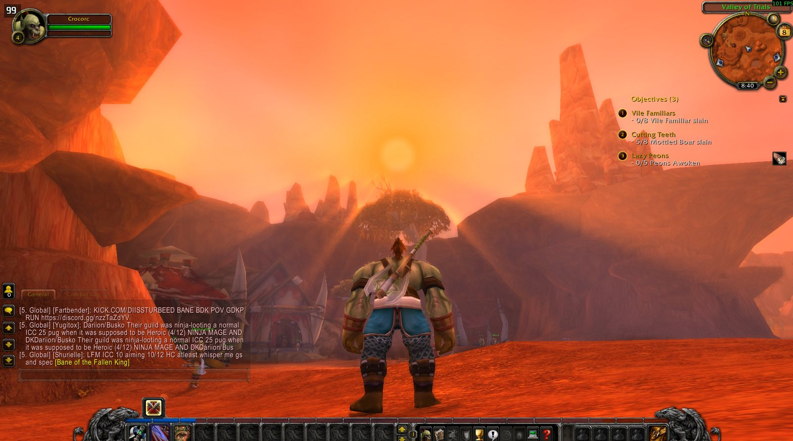</a><br><sub><b>Valley of Trials, gün batımı.</b> Hacimsel sis, güneş parlaması (glare) ve diskten yayılan ışık huzmeleri.</sub></td>
<td width="50%"><a href="docs/images/gallery/02-durotar-topdown-soft-shadows.jpg">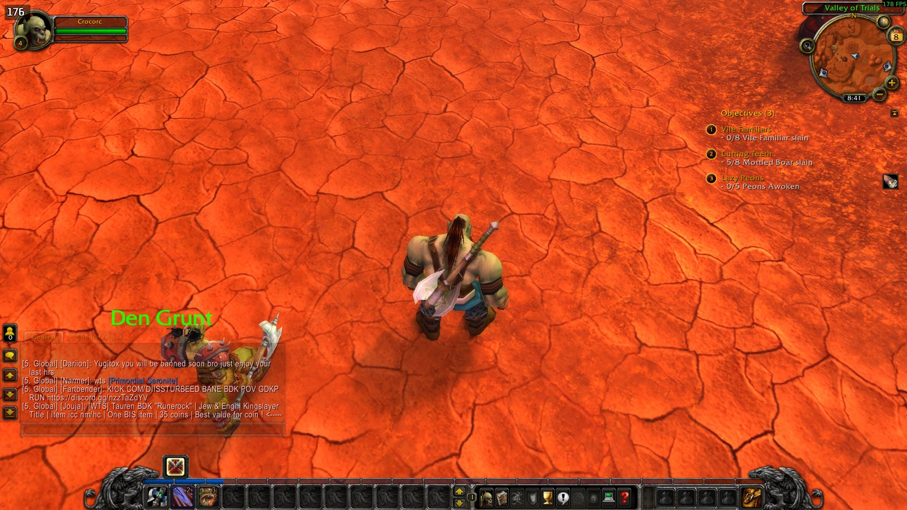</a><br><sub><b>Yukarıdan.</b> Oyunun kendi gölgeleri PCSS ile yumuşatılmış, çatlaklarda AO ve kontakt gölgeleri.</sub></td>
</tr>
<tr>
<td><a href="docs/images/gallery/03-durotar-sun-rays-tree.jpg">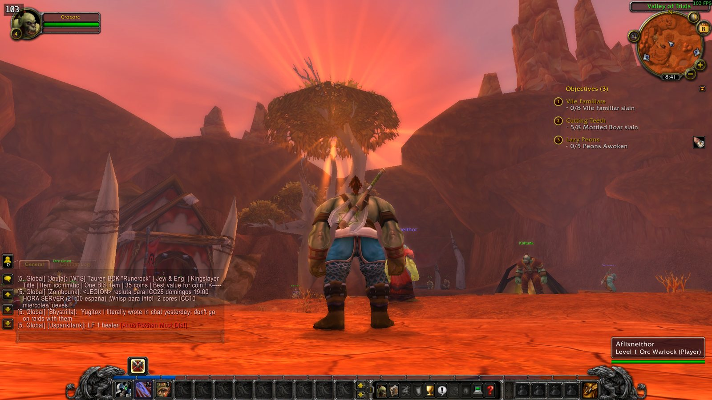</a><br><sub><b>Ağacın arkasındaki güneş.</b> Yapraklar arasından süzülen ışınlar (sun rays) ve aureole.</sub></td>
<td><a href="docs/images/gallery/04-booty-bay-dock-sunset-water.jpg">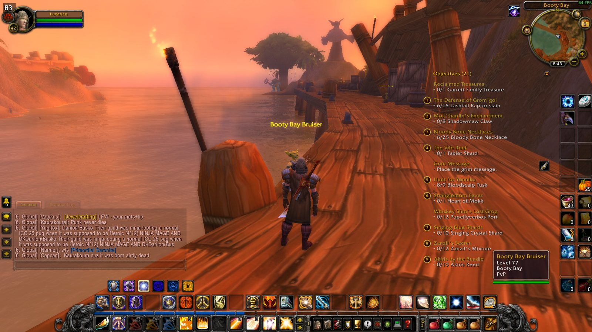</a><br><sub><b>Booty Bay iskelesi.</b> MODERN su: gökyüzü ve kayalık yansımaları, dalgalarla kırılan güneş yolu.</sub></td>
</tr>
<tr>
<td><a href="docs/images/gallery/05-booty-bay-dock-ship-fog.jpg">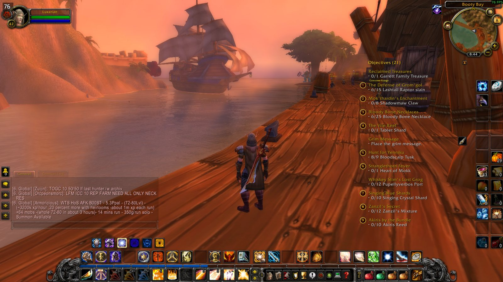</a><br><sub><b>Liman.</b> Mesafeyle yoğunlaşan sis, uzaktaki gemi ve suyun rengi.</sub></td>
<td><a href="docs/images/gallery/06-booty-bay-ship-sun-glare.jpg">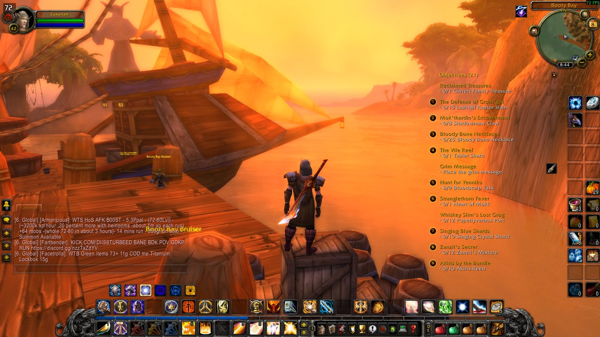</a><br><sub><b>Güneşe karşı.</b> Glare ve ileri saçılım (Henyey–Greenstein) sisi ışıkla dolduruyor; otomatik pozlama ekranı yakmıyor.</sub></td>
</tr>
<tr>
<td><a href="docs/images/gallery/07-booty-bay-morning-mist.jpg">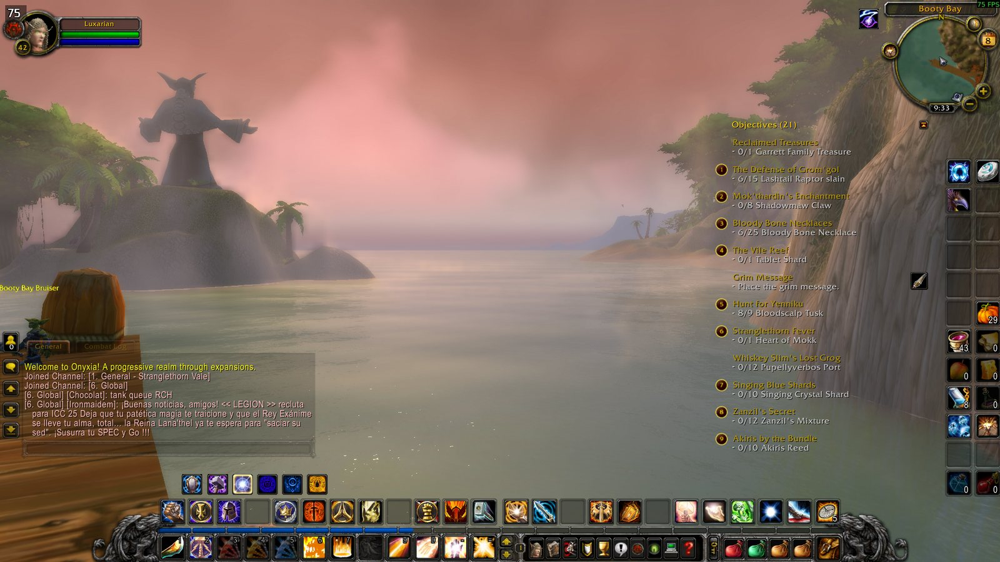</a><br><sub><b>Sabah sisi.</b> Zemine bağlı sis koyun üstünde; su yüzeyinde duruyor, deniz tabanına inmiyor.</sub></td>
<td><a href="docs/images/gallery/08-booty-bay-swimming-shallow-water.jpg">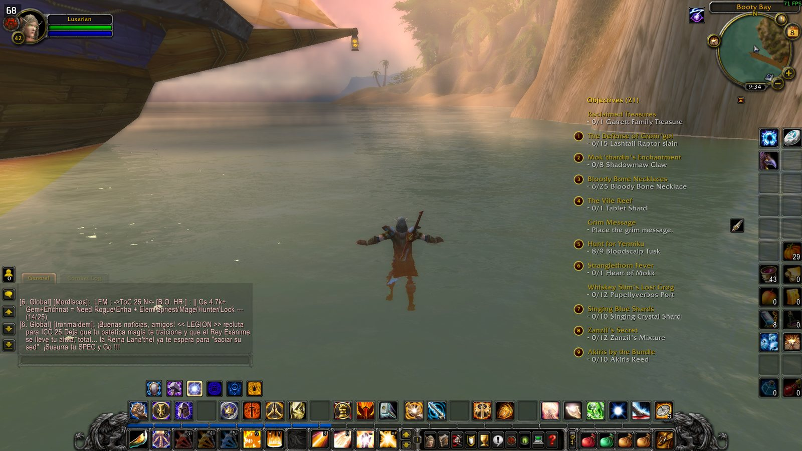</a><br><sub><b>Yüzerken.</b> Sığ suda taban görünüyor; Beer–Lambert soğurmasıyla derinleştikçe renk değişiyor.</sub></td>
</tr>
<tr>
<td><a href="docs/images/gallery/09-booty-bay-under-docks-reflections.jpg">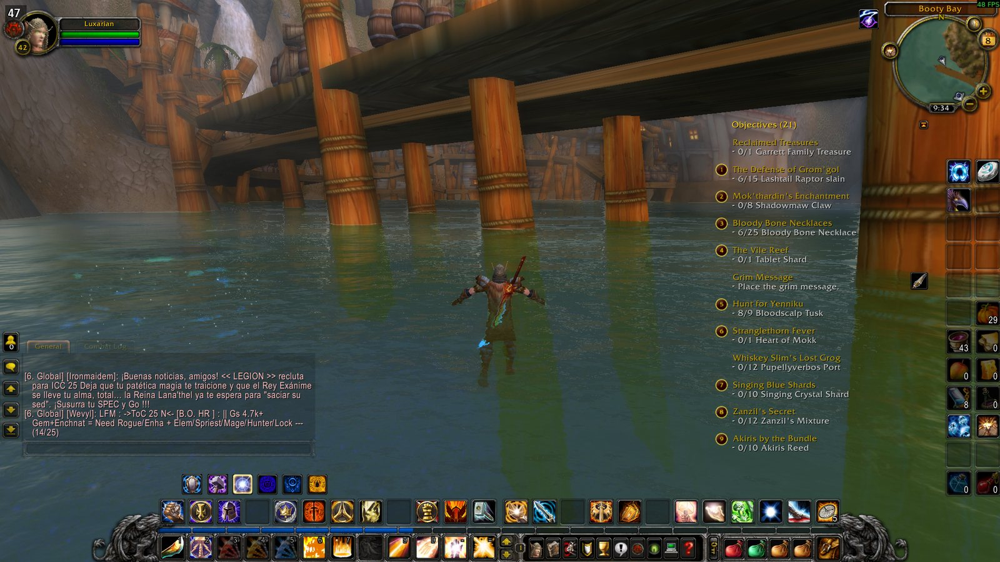</a><br><sub><b>İskele altı.</b> Direklerin ekran-uzayı yansımaları (SSR) ve oyunun dokusundan arındırılmış su rengi.</sub></td>
<td><a href="docs/images/gallery/10-booty-bay-town-light-shafts.jpg">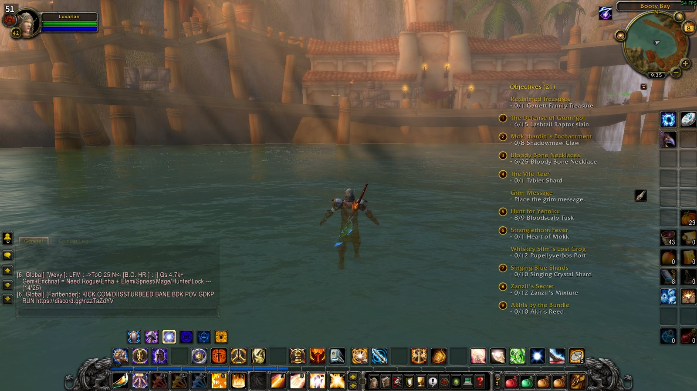</a><br><sub><b>Kasabanın üstü.</b> Binaların arasından sise düşen güneş huzmeleri; güneş haritası ve gölge yürüyüşü.</sub></td>
</tr>
<tr>
<td><a href="docs/images/gallery/11-booty-bay-pink-morning-haze.jpg">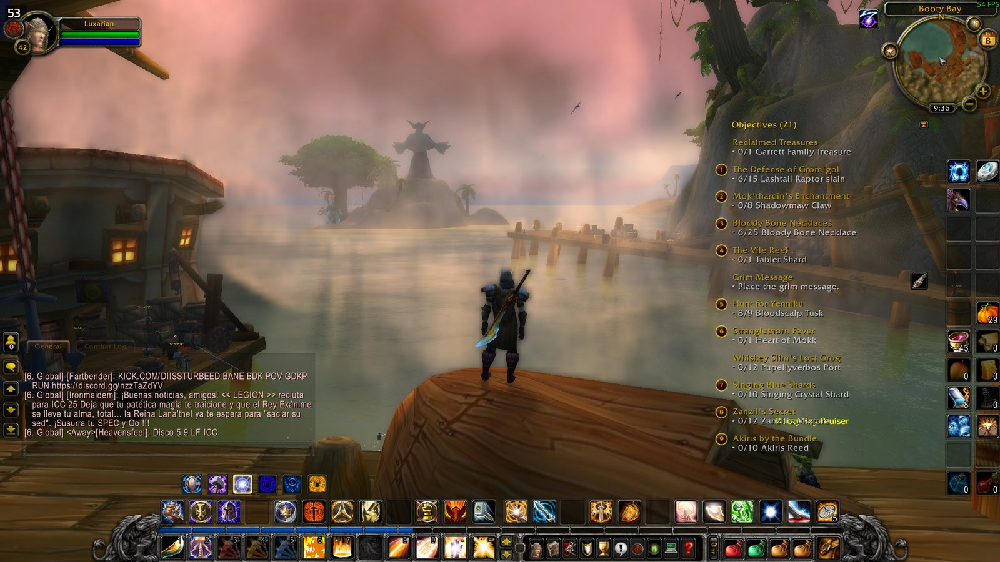</a><br><sub><b>Pembe sabah pusu.</b> Sisin ortam rengi oyunun kendi ışık bloğundan (bölge, günün saati) okunuyor.</sub></td>
<td><a href="docs/images/gallery/12-shadowglen-violet-fog.jpg">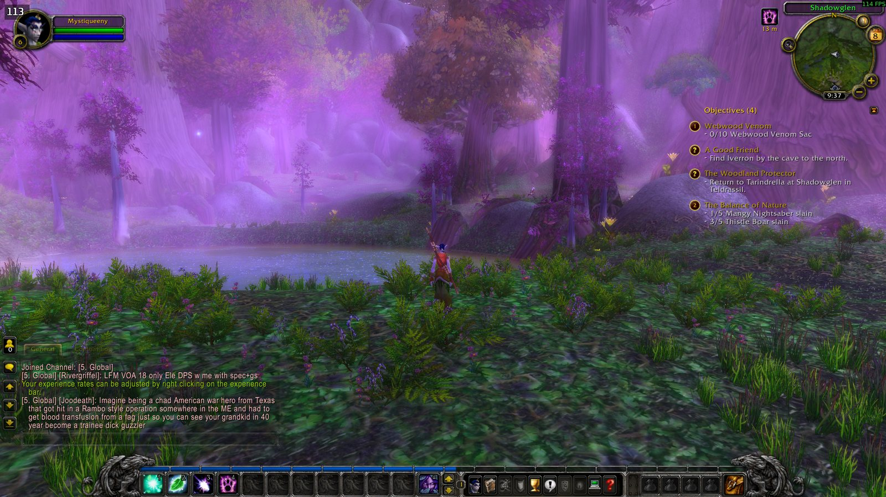</a><br><sub><b>Shadowglen.</b> Teldrassil'in mor ışığı sise geçiyor; ağaç gövdelerinin arasında derinlik.</sub></td>
</tr>
<tr>
<td><a href="docs/images/gallery/13-teldrassil-pond-fog.jpg">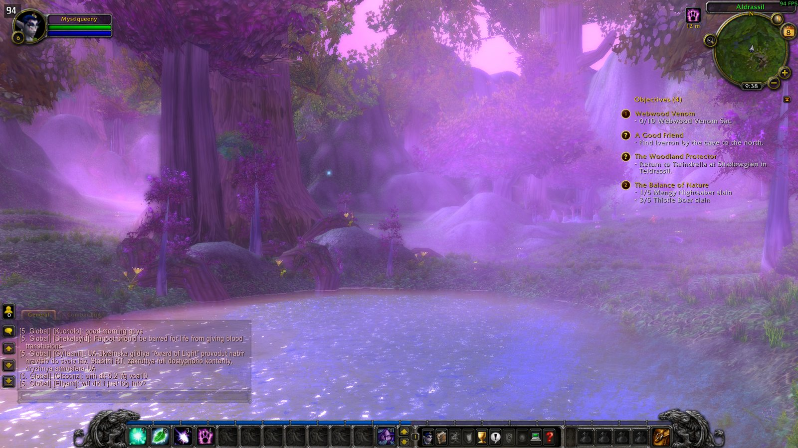</a><br><sub><b>Aldrassil göleti.</b> Göl yüzeyinde su yansıması, üstünde dünyaya sabitlenmiş sis gürültüsü.</sub></td>
<td><a href="docs/images/gallery/14-teldrassil-pond-haze.jpg">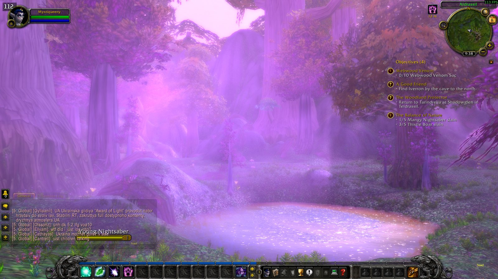</a><br><sub><b>Aynı göl, başka açı.</b> Temporal reprojection sayesinde kamera dönerken titremeyen sis.</sub></td>
</tr>
<tr>
<td><a href="docs/images/gallery/15-mulgore-misty-morning.jpg">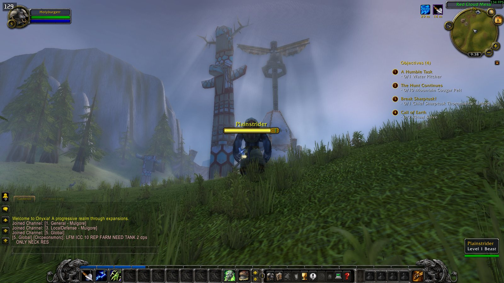</a><br><sub><b>Mulgore, Red Cloud Mesa.</b> Sisli sabah; totemler mesafeyle soluyor, çimen yumuşak gölgede.</sub></td>
<td><a href="docs/images/gallery/16-mulgore-sun-glare-totem.jpg">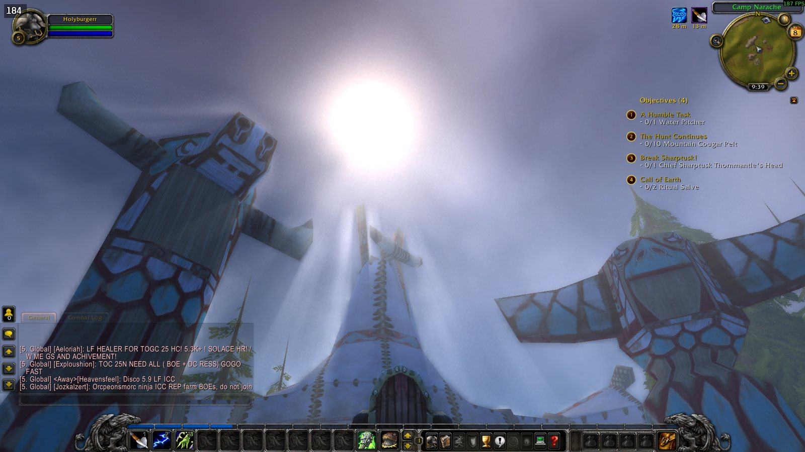</a><br><sub><b>Camp Narache.</b> Güneş diskinin önündeki totem: diskin görünen payı kadar glare, kenarlardan taşan ışık.</sub></td>
</tr>
<tr>
<td><a href="docs/images/gallery/17-durotar-morning-haze.jpg">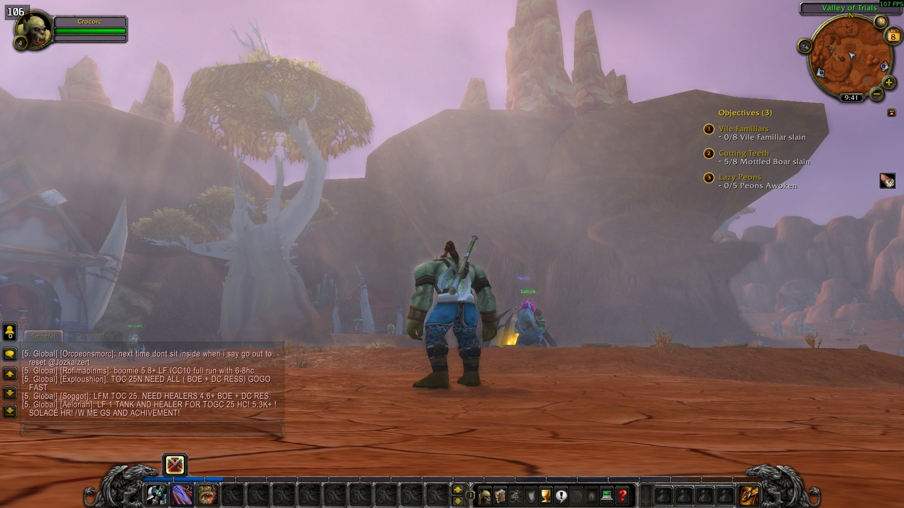</a><br><sub><b>Durotar, sabah.</b> Hafif yükseklik sisi; uzak kayalıklar açık havanın rengine geçiyor.</sub></td>
<td><a href="docs/images/gallery/18-durotar-rays-through-tree.jpg">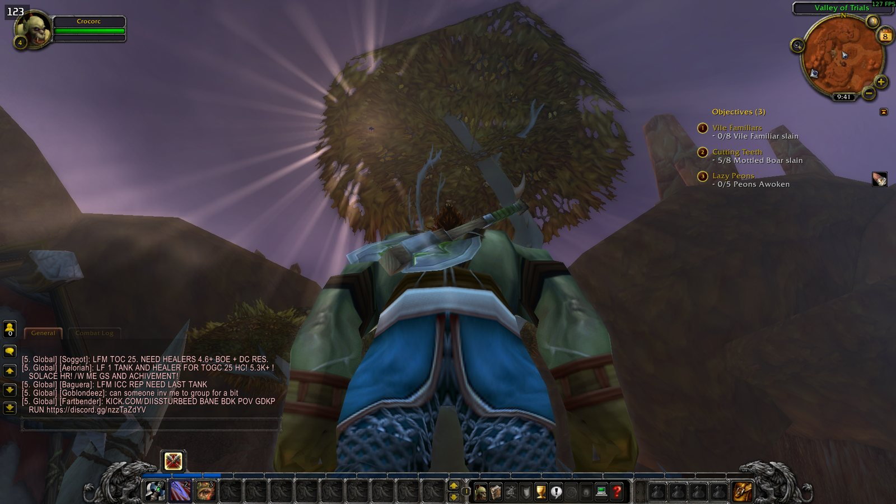</a><br><sub><b>Ağacın arkasındaki güneş.</b> Ekran-uzayında diske doğru yürüyen ışın maskesi: yalnız açıklıklardan geçen huzmeler.</sub></td>
</tr>
<tr>
<td><a href="docs/images/gallery/19-the-den-torches-point-shadows.jpg">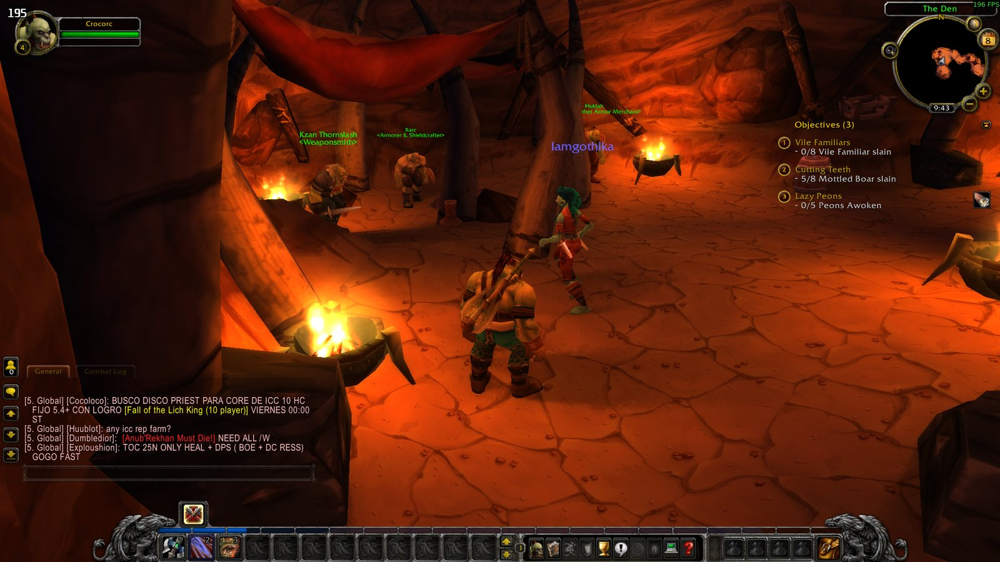</a><br><sub><b>The Den (mağara).</b> Meşaleler oyunun model shader sabitlerinden bulunuyor; her birinden nokta ışık gölgesi.</sub></td>
<td><a href="docs/images/gallery/20-the-den-topdown-torches.jpg">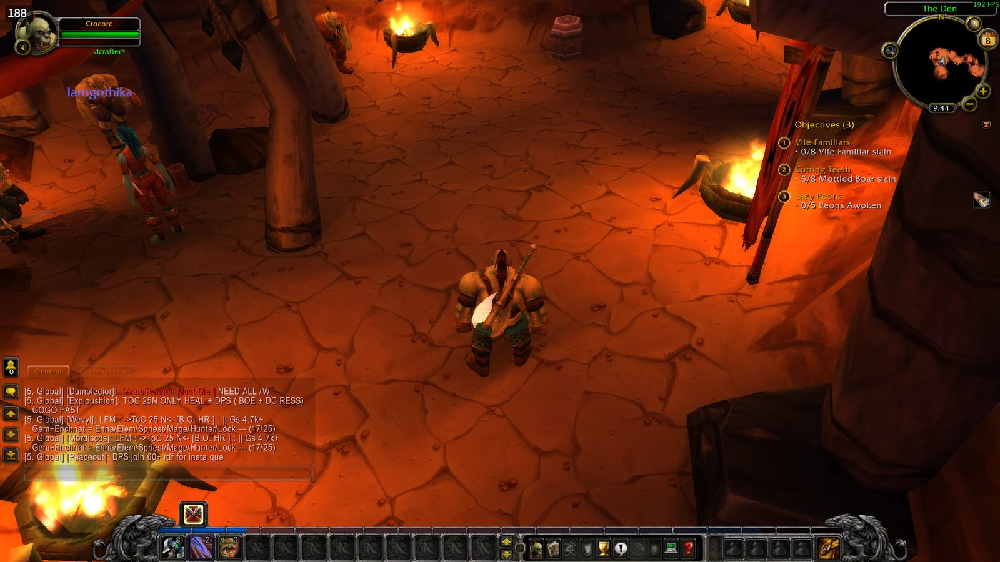</a><br><sub><b>Mağara, yukarıdan.</b> İç mekân gölge haritası ve meşale gölgeleri; köşelerde AO.</sub></td>
</tr>
<tr>
<td><a href="docs/images/gallery/21-durotar-topdown-contact-shadows.jpg">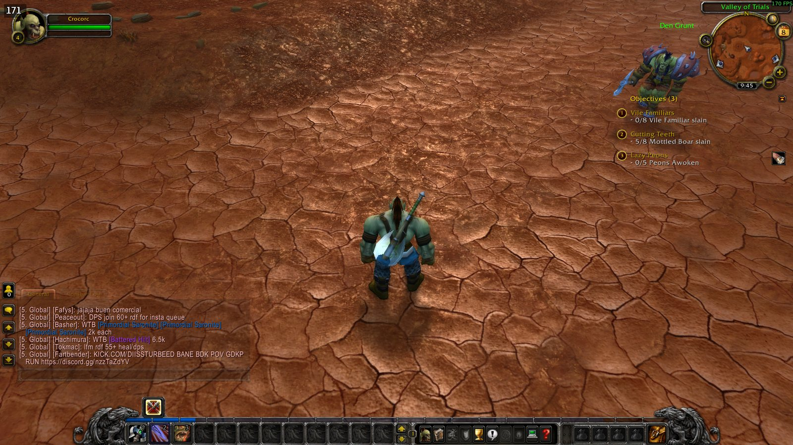</a><br><sub><b>Kontakt gölgeleri.</b> Oyunun 2048'lik gölge haritalarının kaçırdığı küçük ayrıntılar (çatlaklar, ayaklar) için kısa ekran-uzayı yürüyüşü.</sub></td>
<td><a href="docs/images/gallery/22-durotar-topdown-npc-shadows.jpg">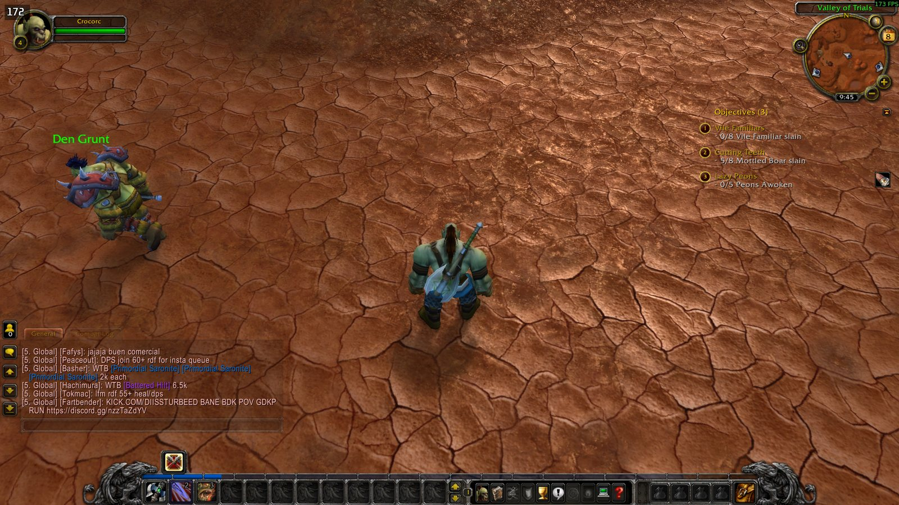</a><br><sub><b>Gölge yumuşaması.</b> Gölge, onu düşüren nesneden uzaklaştıkça genişliyor (PCSS penumbra) ve soluyor.</sub></td>
</tr>
</table>

## Özellikler

### Su ([docs/water.md](docs/water.md))

WoW 3.3.5a'nın suyu düz bir çokgen, üstünde kayan bir doku ve sabit bir alfa. Katman, oyunun su draw'larını kendi gizli geçişlerinde yeniden oynatıyor ve suyu baştan hesaplıyor. Oyunun su shader'ı tanınıyor; aynı dönüşümü kullanan vertex shader varyantları da.

- **Yansımalar:** iki mod var.
  - **SSR:** ekran-uzayında, eşit piksel adımlı yürüyüş.
  - **Planar:** aynı pass'in opak draw'ları aynalanmış kamerayla yeniden çiziliyor.
  - İkisi de tutmazsa kalıcı bir **gökyüzü belleğine** (ekranda görülen gökyüzünün yön haritası) düşülüyor.
  - Birden fazla yatay su seviyesi destekleniyor (ör. Shadowglen'deki iki gölet).
- **Dalgalı yüzey:**
  - Beş Gerstner dalgası, piksel başına ışın–yüzey kesişimiyle hesaplanıyor (Newton, 3 adım). WoW'un su ağı vertex ötelemesi için fazla seyrek.
  - Normaller aynı yüzeyden geliyor; dalga fazları host'ta double hassasiyetle tutuluyor.
- **MODERN stil** (A/B için **CLASSIC** de duruyor):
  - çok ölçekli normaller (oktavlı orta dalgacıklar ve mikro dalgacıklar);
  - pürüzlülüğe duyarlı Schlick Fresnel, GGX güneş lobu ve seyrek parıltılar;
  - parlak ucu HDR'ye genişletilmiş yansıma;
  - kanal başına Beer–Lambert soğurması;
  - dalga tepelerinde alt-yüzey ışığı (SSS);
  - sızıntıya karşı korumalı kırılma;
  - güneş yönünde projekte edilen renk ayrışmalı kostikler;
  - Jacobian'dan whitecap'ler ve kıyı köpüğü.
- **Oyunun dokusu yok:** su gövdesinin rengi, oyunun su renginin mip zincirinden yaklaşık 6 yardlık alanın ortalaması olarak okunuyor. Bölge tonu ve günün saati kalıyor, kayan doku deseni gidiyor.
- **Taban:** oyunun alfa karışımı geri alınarak (`S = (sahne − a·W)/(1 − a)`) suyun altındaki gerçek zemin kurtarılıyor; sığ su berrak görünüyor.
- **Doğruluk korumaları:**
  - Derinlik testi oyununkiyle birebir (D24, `LESS_OR_EQUAL`): kıyı çizgisinde artefakt yok.
  - Oyunun su çizmediği pikseller oyunun çizdiği gibi kalıyor.
  - Suyun üstüne sonradan çizilen efektler (balık sürüleri, parçacıklar) bekletilip su hesaplandıktan sonra üstüne çiziliyor.
- **Dokular:** özgün ve üretilmiş. Dalgacık dokusu, Crest'in normal haritasının **ölçülmüş** spektrumundan yeni fazlarla sentezleniyor; köpük prosedürel, kostikler simüle ediliyor. Hiçbir üçüncü taraf görseli repoda yok.
- **22 hata ayıklama görünümü:** maske, normal, derinlik, yansıma, yer değiştirme, Fresnel, pürüzlülük, SSR güveni, soğurma, kırılma, kostik, ton…

### Hacimsel sis ve ışık ([docs/fog.md](docs/fog.md))

- **Froxel sis:**
  - Kameraya hizalı 3D ızgara (MEDIUM: 160×90×64), üstel dağıtılmış dilimler.
  - Yükseklikle azalan yoğunluk; zemine, kameraya ya da sabit dünya yüksekliğine bağlanabiliyor.
  - Dünyaya sabitlenmiş gürültü ve rüzgârla kayma.
- **Güneş ve hava:**
  - Güneş yönü, rengi ve ortam ışığı **WoW'un belleğinden** okunuyor (ışık bloğu, gökyüzü diski, hava durumu).
  - Yağmurda güneş bulutların arkasında kalıyor.
- **Huzmeler:**
  - Güneş gölgeleri, kalıcı bir yükseklik belleği ve güneş haritası üzerinden froxel başına yürüyüşle hesaplanıyor.
  - İsteğe bağlı olarak oyunun kendi 4 gölge kaskadı kullanılabiliyor.
- **Görsel ekler:**
  - Aureole (dar ileri saçılım lobu).
  - Görünen disk payına göre glare.
  - Disk çevresinden yayılan ekran-uzayı ışınları.
  - Işık tavanı, opaklık tavanı ve otomatik pozlama.
- **Kararlılık:** temporal reprojection (Halton jitter). Hareket sırasında geçmişin ağırlığı azalıyor, sahne kesildiğinde sıfırlanıyor.
- **Doğru ekleme noktası:** sis, dünya pass'leri bitince ve UI çizilmeden önce eklenir, yani UI sislenmez. Su yüzeyinde durur. Parçacıklar isteğe bağlı olarak sisten sonra çizilir (`transparent_fog`).

### Gölgeler ve sahne gölgelendirmesi

- **Yumuşak oyun gölgeleri:**
  - WoW'un piksel shader'larındaki her gölge örneği, pipeline oluşturulurken SPIR-V düzeyinde **PCSS**'e yeniden yazılıyor: blocker araması ve nesneden uzaklaştıkça büyüyen penumbra.
  - Gölge, nesneden uzaklaştıkça soluyor.
  - İç mekân gölge haritasının gücü ayarlanabiliyor.
- **Gölge kenarı:** oyunun 9 örnekli PCF yayılımı, piksel sabitlerinden genişletiliyor.
- **Sahne gölgelendirmesi** (sisten önce, yarım çözünürlükte):
  - ambient occlusion;
  - kontakt gölgeleri (ekran-uzayında güneşe kısa yürüyüş);
  - arazi gölgeleri (100 yardlık yürüyüş; oyunun kaskadlarına girmeyen tepeler);
  - meşale ve ateşlerden **nokta ışık gölgeleri**.
- **Oyunun ışıkları:** nokta ışıklar, WoW'un model vertex shader sabitlerinden okunuyor (konum, renk, menzil) ve isteğe bağlı olarak gizmo olarak çiziliyor ([docs/lights.md](docs/lights.md)).
- **Oyunun mesafe sisi:** vertex sabitlerindeki fog register'ı yeniden yazılarak uzatılıyor ya da kapatılıyor.

### Inspector ve keşif ([docs/inspector.md](docs/inspector.md))

- **Yüzey seçme:** ekrandaki bir yüzeye tıklanınca onu çizen draw bulunuyor. GPU kapsama testiyle "sonraki/önceki GPU isabeti" arasında gezilebiliyor; seçilen draw sarıya boyanıyor.
- **Ayrıntılar:** shader'lar, texture'lar (format, mip, sampler), vertex/index buffer'ları ve uniform değerleri.
- **Dışa aktarma:** texture'ları BMP olarak (BC sıkıştırması GPU'da çözülüyor), shader'ları SPIR-V olarak ve bir manifest.
- **Pipeline explorer ve izolasyon:** bir draw'ı gizle, yalnız onu göster, geri getir.
- **Kare taramaları:** bütün bir kareyi açıklayan sıralı raporlar (pass'ler, draw sınıfları, alfa testi, gölge haritaları).
- **Semantik draw sınıfları:** SKY, OPAQUE, ALPHA_TEST, WATER, TRANSPARENT, ADDITIVE, UI ([docs/draw-classes.md](docs/draw-classes.md)).

### Kamera ve sahne hata ayıklayıcı

- WoW'un `CGCamera` yapısı süreç belleğinden okunuyor (kanonik poz, FOV, near/far). Su shader'ının kamera sabitleriyle çapraz doğrulanıyor.
- Derinlikten dünya konumu rekonstrüksiyonu ve görünümleri (Shift+F6).
- Kamera telemetri HUD'u, kayıt, işaretleyiciler, 3D gizmolar.
- Kamera adaylarını kanıtıyla sıralayan **Scene Debugger** sayfası.

### Eski efektler ([docs/postfx.md](docs/postfx.md))

Projenin ilk aşamasından kalan tam ekran efektler. Demo olarak duruyorlar ve varsayılan kapalılar: rainbow/heartbeat, legacy AO, SSAO, sharpen, kromatik sapma, kontur, genel SSR.

## Kurulum ve çalıştırma

### Gereksinimler

- Linux, Steam + Proton (DXVK). Geliştirme Nobara/Fedora üzerinde yapıldı.
- 32-bit Vulkan sürücüsü (oyun 32-bit). Test donanımı NVIDIA GTX 1660 Ti.
- `cmake`, `ninja`, 32-bit g++ (`-m32`) ve `glslc` (shaderc).
- `python3` + `numpy` (dokular üretiliyor), araçlar için `Pillow` ve `scipy`.

### Derleme

```bash
cmake -S . -B build32 -G Ninja -DCMAKE_BUILD_TYPE=Release -DCMAKE_CXX_FLAGS=-m32 -DCMAKE_SHARED_LINKER_FLAGS=-m32 -DDEPTH_PROBE_BUILD_TESTS=ON
cmake --build build32          # 32-bit katman: build32/libVkLayer_depth_probe.so
./tools/build-shaders.sh       # GLSL -> SPIR-V (CMake bunu yapmaz)
```

Shader'lar çalışma anında `shaders/` dizininden okunur. Bir `.frag`/`.comp` değişikliği `build-shaders.sh` çalışana kadar etkisizdir. Katman ya da shader arayüzü değişince oyunu tamamen kapatıp yeniden açın.

### Oyunu başlatma

Steam → WoW → Properties → Launch Options:

```text
/mnt/Games/Projects/vulkan-depth-probe/tools/run-inspector.sh %command%
```

Başlatıcı şunları yapar:

- `build32` katmanını yükler.
- Eksikse su dokularını üretir (`water_detail.bin`, `water_modern.bin`).
- Inspector'ı açar ve sisi açık başlatır (`DEPTH_PROBE_FOG_START=1`).
- DXVK descriptor buffer'larını kapatır (Inspector descriptor set'leri çözer).
- Logu `~/vulkan-depth-probe.log` dosyasına yazar.

Oyunda multisampling **1** olmalı.

İlk çalıştırmada su yansıması WoW su profiliyle kendiliğinden açılır. Ayarlar `~/.config/vulkan-depth-probe/` altında saklanır.

## Kısayollar

| Tuş | İş |
| --- | --- |
| **F10** | Menüyü aç/kapat (açıkken klavye ve fare oyundan alınır) |
| **Shift+F5** | Hacimsel sis: KAPALI → FINAL → FROXEL DENSITY → EXTINCTION → LIGHTING → INTEGRATED SCATTERING → TRANSMITTANCE → SUN VISIBILITY |
| **Shift+F6** | Derinlik → dünya rekonstrüksiyon görünümleri |
| **F9** / **Shift+F9** | Kamera telemetri HUD'u / kayıt başlat-durdur |
| **F8** / **Shift+F8** | Kamera gizmosu / gizmo kamera kaynağı (AUTO, WATER, MEMORY) |
| **F7** / **Shift+F7** | Gizmoyu sabitle / bellek kamerası taraması |
| **F6**, **Ctrl+1..9** | Kayda işaretleyici |

Kısayollar pasif tuş yoklamasıyla okunur ve F10 kapalıyken de çalışır. KDE'nin yakaladığı Ctrl+F tuşları bilinçli olarak kullanılmıyor.

## Menüler (F10)

Menü, katmanın kendi çizdiği küçük bir paneldir (ImGui yok; font shader'ın içinde gömülü). Satırlara fareyle tıklanır. Her tıklama değeri bir sonraki adıma geçirir ve ayar dosyasına anında kaydeder.

### Ana sayfa — *GRAPHICS INSPECTOR*

| Satır | Açtığı sayfa |
| --- | --- |
| INSPECT SURFACE | Dünyaya tıklayıp yüzey seçme modu |
| SELECTED SURFACE | Seçili draw'ın özeti, GPU isabetleri arasında gezinme |
| EXPORT SELECTED ASSETS | Texture (BMP), shader (SPIR-V) ve manifest dışa aktarımı |
| ADVANCED – PIPELINE EXPLORER / SETTINGS | Pipeline gezgini, izolasyon, eski FX ayarları |
| SCENE DEBUGGER – RANKED FINDINGS | Kamera, derinlik ve su kamerası bulguları, kamera adayları |
| SHADOWS AND OCCLUSION | Gölge ve AO sayfası |
| WATER REFLECTIONS – SSR / PLANAR | Su sayfası |
| VOLUMETRIC FOG | Sis sayfası |

### Selected Surface / Textures / Shaders / Export

- **Selected Surface:**
  - ekran konumu, derinlik, VS/FS kimlikleri;
  - malzeme ve mesh adayları;
  - etkin durum (depth write, blend, cull, topology), hedef boyutu, texture sayısı, vertex/index buffer'ları;
  - `NEXT GPU HIT` / `PREVIOUS GPU HIT`: aynı pikseli kapsayan draw'lar, çizim sırasıyla.
- **Textures:** set/binding/element, image/view kimliği, format, boyut, mip/layer, sampler filtreleri ve adresleme.
- **Shaders:** VS ve FS'nin SPIR-V anlık görüntüleri (modül yok edilse de saklanır).
- **Export:** seçili texture'ı ya da hepsini dışa aktarır. Dosya adları set/binding/kimlik içerir; manifest kaydedilenleri ve kaydedilemeyenleri listeler.

### Water Reflections

| Satır | Değerler |
| --- | --- |
| USE SELECTED WATER CANDIDATE | Inspector'da seçilen su draw'ını su profili yapar (WoW suyu için ilk çalıştırmada kendiliğinden) |
| MODE | OFF → SSR → PLANAR |
| VIEW | 22 hata ayıklama görünümü: FINAL, MASK, NORMAL, WATER DEPTH, REFLECTION, BASE SURFACE, DISPLACEMENT, LARGE WAVES, MEDIUM/MICRO/FINAL NORMAL, FRESNEL, ROUGHNESS, SSR CONFIDENCE, PLANAR WEIGHT, ENVIRONMENT WEIGHT, SUN GLINTS, WATER THICKNESS, ABSORPTION, REFRACTION, CAUSTICS, WATER TINT |
| STRENGTH | Yansımanın gücü |
| CAPTURE DEBUG DATA | Bir sonraki su pass'inin tüm girdilerini `exports/water-capture-*` altına yazar |
| STYLE | MODERN ↔ CLASSIC (A/B) |
| LAYERS | ALL, REFLECTION, REFLECTION+WAVES, REFLECTION+DEPTH+FOAM, NO REFLECTION |
| TONE | NATURAL, TROPICAL, DEEP BLUE, EMERALD, GOLDEN |
| WATER DETAILS | Alt sayfa (aşağıda) |
| PERFORMANCE TEST | 40 saniyelik otomatik A/B: suyla ve susuz kare süresi |

**Water Details:**

- **Köpük:** miktar, desen boyutu, hız, yumuşaklık, gelip gitme, kıyıya erişim.
- **Doku:** su doku ayrıntısı, oyunun doku opaklığı (CLASSIC).
- **Taban:** sığ su berraklığı, taban kostikleri.
- **Yüzey:** güneş parıltısı, açık deniz whitecap'leri, dalga yüksekliği ve dikliği.
- **MODERN:** pürüzlülük, orta dalgacıklar, mikro dalgacıklar, alt-yüzey ışığı.
- **Diğer:** yansıma kalitesi (LOW/MEDIUM/HIGH), ayrıntıları varsayılana döndür.

### Volumetric Fog

Sırasıyla:

- **Görünüm ve kalite:** VIEW (Shift+F5 ile aynı döngü), QUALITY (LOW / MEDIUM / HIGH froxel ızgarası).
- **Yoğunluk ve yükseklik:** DENSITY, HEIGHT FALLOFF, HEIGHT REFERENCE (GROUND / CAMERA / WORLD Z), BASE, MAX DISTANCE.
- **Saçılım ve ortam:** FORWARD SCATTER G, ALBEDO, AMBIENT LIGHT (oyunun ortam ışığı × ölçek), AMBIENT COLOR (oyun / fog.ini).
- **Güneş:** SUN LIGHT (şiddet), SUN DIRECTION (gökyüzü diski / oyun ışığı / fog.ini), SUN SHADOWS (yürüyüş uzunluğu), SKY LIGHT FROM ABOVE, OPEN-SKY SUN.
- **Kararlılık ve gürültü:** TEMPORAL, NOISE, NOISE SCALE, NOISE DRIFT.
- **Hazır görünüm:** LOOK: FOREST LIGHT SHAFTS. Yukarıdaki satırları ölçülerek seçilmiş huzme değerlerine ayarlar.
- **Diğer:**
  - LIGHT GIZMO ve LIGHT SOURCES: hata ayıklama işaretleri.
  - GAME FOG: WoW'un mesafe sisi (AS THE GAME / ×N FARTHER / OFF).
  - CAPTURE FOG DATA.
  - RESET TO DEFAULTS: "her şey açık" görünüm.

### Shadows and Occlusion

| Satır | İş |
| --- | --- |
| SHADOW EDGES | Oyunun gölge filtresinin yayılımı (×1 … ×3) |
| SOFT SHADOWS | PCSS penumbra boyutu (oyun açılışında yamalanır; sonrasında canlı) |
| SHADOW FADE / FADE DISTANCE | Gölgenin nesneden uzaklaştıkça solması |
| CONTACT SHADOWS | Kısa ekran-uzayı güneş gölgeleri |
| AMBIENT OCCLUSION | Köşeler, duvar dipleri, ağaç altları |
| TERRAIN SHADOWS / TERRAIN SHADOWS FROM | Tepe ve uçurum gölgeleri; kameradan hangi mesafeden başlayacağı |
| POINT LIGHT SHADOWS / RANGE / IGNORE / LENGTH | Meşale ve ateş gölgeleri: güç, menzil, ışığın kendi çevresi, gölgenin uzunluğu |
| INDOOR SUN SHADOWS | İç mekân gölge haritasının gücü |

## Mimari

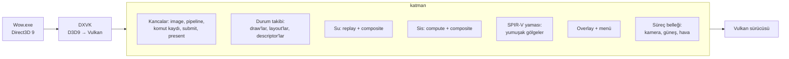

Katman her Vulkan çağrısını sonraki katmana aynen iletir; yalnızca şu noktalarda iş yapar:

| Kanca | Yapılan |
| --- | --- |
| `vkCreateImage` | Sahne derinliğine aday image'lara `SAMPLED` usage ekler; tam swapchain boyutundaki derinliği seçer |
| `vkCreateGraphicsPipelines` | Gölge alan piksel shader'larının SPIR-V'sini PCSS'e yeniden yazar; su pipeline'ının tarifini saklar |
| `vkCmd*` (kayıt) | Bağlı pipeline/set/buffer/dinamik durumu ve layout olaylarını izler. Draw'ları sınıflandırır, gerekirse anlık görüntüsünü alır. Suyun ya da sisin üstüne gelecek efektleri bekletir. Oyunun gölge/sis sabitlerini draw başına değiştirir |
| `vkCmdEndRendering` / `EndRenderPass` | **Su işi:** su draw'larını gizli bir maske pass'inde yeniden oynatır, sonra composite'i kaydeder |
| Dünya sonrası ilk pass | **Sis composite'i:** UI'dan önce. Bekletilen parçacıkları sonra yeniden çizer |
| `vkQueueSubmit` | Sisin compute işini, oyunun ilgili submit'inden hemen önce aynı queue'ya gönderir; zaman damgalarını toplar |
| `vkQueuePresentKHR` | Overlay ve menüyü çizer. Kare başına `vkQueueWaitIdle` yok; semaphore zinciriyle senkronize ([docs/architecture.md](docs/architecture.md)) |

### Bir karede su

1. Oyun, dünya pass'inde suyu çizer (alfa karışımlı, derinlik yazmaz).
2. Pass bitince katman, aynı su draw'larını kendi pipeline'larıyla **maske pass'inde** yeniden oynatır. Çıktılar:

   - her pikselde su yüzeyinin view-space konumu ve alfası;
   - oyunun su shader'ının kendi rengi W (shader'a ikinci bir çıktı eklenir).
3. W'nin mip zinciri blit'lerle kurulur (dokusuz ton için).
4. Sahne rengi kopyalanır; ekranda görünen gökyüzü kalıcı **gökyüzü belleğine** katlanır.
5. **Composite**, oyunun renk görüntüsüne tam ekran çizilir. Her su pikseli için:

   - Gerstner yüzeyiyle kesişim bulunur;
   - taban kurtarılır;
   - normaller, Fresnel, yansıma (planar → SSR → gökyüzü), güneş, soğurma, kırılma, kostik ve köpük hesaplanır.
6. Suyun üstüne gelecek bekletilmiş efektler yeniden çizilir. Uygulamanın tüm bağları ve dinamik durumu geri kurulur.

### Bir karede sis

1. **Compute:** katmanın kendi komut buffer'ında, oyunun submit'inden önce çalışır:

   - bellekler: zemin, yükseklik, güneş haritası, disk bulucu;
   - inject (yoğunluk ve gürültü);
   - light (güneş, ortam, gölge yürüyüşü);
   - integrate (önden arkaya analitik integral, temporal).
2. **Shade:** sahne derinliğinden yarım çözünürlükte AO, kontakt, arazi ve nokta ışık gölgeleri.
3. **Composite:** `renk·T + inscatter`. Pozlama, glare ve ışınlar eklenir; su piksellerinde mesafe su yüzeyine kadardır.
4. `transparent_fog` açıksa bekletilen parçacıklar sisin üstüne çizilir.

### Kod haritası

| Alan | Dosyalar |
| --- | --- |
| Dispatch, yaşam döngüsü | `layer.cpp`, `src/layer_state.*` |
| Derinlik, swapchain, present | `src/depth_tracking.*`, `depth_selection.cpp`, `swapchain_tracking.cpp`, `present.cpp`, `sync_*`, `overlay_sync.cpp` |
| Overlay ve menü | `src/overlay_*`, `inspector_ui.cpp`, `camera_hud_input.*` |
| Komut takibi, keşif, Inspector | `src/discovery_*.cpp`, `pipeline_discovery.*`, `inspector_*.cpp`, `draw_classifier.*`, `draw_semantics.*`, `draw_segments.*` |
| Su | `src/water_reflections.*`, `water_resources.cpp`, `water_capture.cpp`, `water_spirv.cpp`, `water_surface.*` (Gerstner, CPU referansı), `water_shading.*` (Fresnel/soğurma referansı); `shaders/water_composite.frag`, `water_surface.glsl`, `water_camera.frag`, `water_sky.frag` |
| Sis ve sahne gölgelendirmesi | `src/volumetric_fog.*`, `fog_math.*` (CPU referansı); `shaders/fog_*.comp/.frag/.vert` |
| Oyunun gölgeleri, sisi, ışıkları | `src/game_soft_shadows.*`, `spirv_soft_shadows.*`, `game_pcf.*`, `game_fog*.*`, `game_lights*.*` |
| Kamera ve bellek | `src/memory_camera*.*`, `memory_sun.*`, `process_memory.*`, `camera_math.*`, `camera_analyzer.*`, `depth_reconstruction.*`, `scene_debugger.*` |

## Teknikler

| Teknik | Nerede | Not |
| --- | --- | --- |
| Oyunun alfa karışımını geri alma | su | `S = (sahne − a·W)/(1 − a)`. W ve a, su draw'ının yeniden oynatılmasından; premultiplied karışım da destekli |
| Tutarlılık testi + D24 derinlik öykünmesi | su | Geri alınan taban [0,1] dışındaysa piksel oyunun suyu değildir. Derinlik farkı toleransı 2e-7 (ölçüldü) |
| Mip zinciri tonu, kübik B-spline okuma | su | Sabit ekran seviyesi yerine dünya boyutunda (~6 yd) ortalama. 4 bilinear örnekle B-spline |
| Gerstner dalgaları, Newton kesişimi | su | Piksel başına ışın–yüzey kesişimi; CPU ve GPU aynı tanım (`water_surface.cpp` = `.glsl`) |
| Schlick Fresnel + pürüzlülük tavanı | su | R0 = 0.02 (n = 1.333, ölçüldü), Lagarde'ın tavanı |
| GGX + Smith görünürlüğü, Toksvig | su | Mip'in ortaladığı mikro eğim varyansının yarısı pürüzlülüğe eklenir |
| Beer–Lambert, kanal başına | su | Saf su soğurması (Pope & Fry 1997); berraklık ölçeği |
| SSR: eşit piksel adımlı 1/z yürüyüşü | su | Kalınlık adım boyuna göre büyür; ekran kenarında güven azalır |
| Planar yansıma | su | Opak draw'lar aynalanmış matrisle, aynı pass içinde yeniden çizilir |
| Gökyüzü belleği | su | Görülen gökyüzünün yön haritası (128×64) |
| Crest tarzı kostikler | su | Güneş boyunca projeksiyon, renk ayrışması; dik tabanda ve su çizgisinde sönüm |
| Jacobian whitecap'ler | su | Sıkışma / Σ QkA, dalga dikliğiyle (Σ kA) kapılı |
| Spektrumdan doku sentezi | araç | Crest'in normal haritasının ışınsal eğim spektrumu ölçülüp yeni fazlarla üretilir |
| Draw bekletme ve yeniden çizim | su, sis | Uygulamanın kendi pipeline'larıyla, aynı komut buffer'ında, yeni bir rendering örneğinde |
| Froxel hacimsel sis | sis | Frostbite'ın analitik dilim integrali, üstel dilimler |
| Henyey–Greenstein + aureole lobu | sis | İki loblu faz fonksiyonu |
| Temporal reprojection | sis | Halton jitter; hareket ve sahne kesimine duyarlı geçmiş |
| Yükseklik belleği ve güneş haritası | sis | Ekran dışındaki örtü de gölge verir; ışınlanmada unutulur |
| Ekran-uzayı güneş ışınları | sis | GPU Gems 3, bölüm 13; diskin görünen payıyla ölçekli glare |
| Otomatik pozlama | sis | Parlak kısmın anahtarı ölçülür; yalnız karartır, UI'ya dokunmaz |
| Horizon tabanlı AO, ekran-uzayı gölge yürüyüşleri | gölge | Kontakt, arazi ve nokta ışık gölgeleri; kenarda normal yok |
| SPIR-V'de PCSS | gölge | Oyunun gölge örnekleri blocker araması ve penumbra ile yeniden yazılır; canlı değerler DXVK'nın paylaşılan piksel verisinden |
| Shader sabitlerini yeniden yazma | oyun | PCF yayılımı, mesafe sisi, iç mekân gölgesi |
| Süreç belleği okuma | kamera, sis | CGCamera, ışık bloğu (güneş yönü, renkler), hava durumu nesnesi |
| SPIR-V yorumlayıcısı | araştırma | `tools/spirv-eval.py`: oyunun shader'larını kare taramasındaki sabitlerle çalıştırır (gölge haritası ekseni böyle bulundu) |

Ayarların yanına konan **ÖLÇÜLDÜ / ÇIKARIM / SEZGİSEL / AYAR** etiketleri, bir değerin nereden geldiğini gösterir. Belgeler ve shader yorumları bu kuralı izler.

## Ayar dosyaları

`~/.config/vulkan-depth-probe/` (ya da `$XDG_CONFIG_HOME`):

| Dosya | İçerik |
| --- | --- |
| `water.ini` | Profil, mod, güç, katmanlar, ton, stil ve bütün su ayrıntıları. `wave1..5` (yön, dalga boyu, genlik, diklik, hız), `wind_direction`, `wave_speed`, `absorption`, `sun_fallback` |
| `fog.ini` | Sis, ışık, gölge ve sahne gölgelendirmesinin tamamı, yorumlu. Değişiklikler yaklaşık bir saniyede canlı okunur |
| `settings.ini` | Eski FX menüsü |

Kod içi varsayılanlar "her şey açık" görünümdür. Menüdeki RESET TO DEFAULTS da buna döner.

## Ortam değişkenleri

| Değişken | Davranış |
| --- | --- |
| `DEPTH_PROBE_FOG_START=1` | Sis açık başlar (başlatıcının varsayılanı; `0` kapalı başlatır) |
| `DEPTH_PROBE_DEPTH_PRESENT=1` | Overlay çizimi açık |
| `DEPTH_PROBE_SURFACE_INSPECTOR=1` | Inspector (başlatıcı verir) |
| `DEPTH_PROBE_LAYER_LOG` | Log yolu (başlatıcı: `~/vulkan-depth-probe.log`) |
| `DEPTH_PROBE_SHADER_DIR` | SPIR-V ve doku dizini (varsayılan: projenin `shaders/` dizini) |
| `DEPTH_PROBE_EXPORT_DIR` | Dışa aktarım ve yakalama kökü (başlatıcı: `exports/`) |
| `DEPTH_PROBE_WATER_SETTINGS`, `DEPTH_PROBE_FOG_SETTINGS` | Ayar dosyalarının yolları |
| `DEPTH_PROBE_WATER_CAPTURE=0` | Açılıştaki otomatik su yakalamalarını kapatır (her biri ~100 MB) |
| `DEPTH_PROBE_GPU_TIMING=1` | Overlay GPU süresi `[FRAME-PERF]` satırında |
| `DEPTH_PROBE_INSPECTOR_AUTO_CONSTANTS=0` | Seçimde otomatik uniform/shader kaydını kapatır |
| `DEPTH_PROBE_PIPELINE_EXPLORER=1` | Pipeline gezgini |
| `DEPTH_PROBE_DRAW_CLASSES=0` | Draw sınıflandırmasını kapatır |
| `DEPTH_PROBE_MEM_CAMERA=0` | Bellekten kamera okumayı kapatır. `DEPTH_PROBE_MEM_CAMERA_STATIC/OFFSET/ADDR/FIELDS/ROWS`, `DEPTH_PROBE_MEM_FOV_AXIS/SCALE` adresleri ve alanları değiştirir |
| `DEPTH_PROBE_GIZMO_SOURCE` | Gizmo kamera kaynağı (`auto`, `water`, `memory`). `DEPTH_PROBE_GIZMO_*_OFFSET/SIZE` boyutları |
| `DEPTH_PROBE_SHADER_HOT_RELOAD=1` | Eski overlay shader'ları için 500 ms'de bir yeniden yükleme |
| `DEPTH_PROBE_SCENE_COLOR=1`, `DEPTH_PROBE_SSAO=1`, `DEPTH_PROBE_SSR=1` | Eski FX önkoşulları |
| `DEPTH_PROBE_MENU_VISIBLE=1`, `DEPTH_PROBE_UI_INPUT=0`, `DEPTH_PROBE_UI_SHARED_POINTER=0` | Menü ve giriş davranışı |
| `DEPTH_PROBE_WATER_FREEZE=1` | Yalnız testler: sabit dalga zamanı |

## Araçlar

Oyun açıkken, menüye dokunmadan veri çekmek için katman, `exports/` altında **istek dosyalarını** yoklar:

| Komut | İş |
| --- | --- |
| `tools/frame-scan.py --request` | Bütün kareyi tarar ve sıralı bir rapor üretir (pass'ler, sınıflar, alfa testi, gölge haritaları) |
| `tools/fog-capture.py --request` | Sisin bir karesini (sis öncesi/sonrası renk, hacimler, bellekler) yakalar ve özetler |
| `touch exports/water-capture-request` | Bir sonraki su pass'ini yakalar |
| `tools/water-preview.py <capture>` | Su composite'ini yakalanmış bir kare üzerinde GPU'da yeniden çalıştırır ve PNG yazar; debug görünümü, stil, güneş ve süre (ms) seçenekleri var |
| `tools/fog-whatif.py`, `fog-shafts.py` | Sis yakalaması üzerinde "şu ayarla ne olurdu" yeniden çizimi ve huzme ölçümü |
| `tools/spirv-eval.py`, `spirv-trace.py` | Oyunun SPIR-V'sini çalıştıran yorumlayıcı ve izleyici |
| `tools/light-constants.py`, `shadow-constants.py`, `cascade-check.py`, `find-sun-direction.py` | Işık, gölge ve güneş sabitlerinin araştırması |
| `tools/generate-modern-water-textures.py` | MODERN su dokuları (özgün). `--crest DIR` ile yerel bir Crest kopyasından çevirir; bu dokular repoya girmez |
| `tools/generate-water-textures.py` | CLASSIC su dokuları |
| `tools/discovery-report.py`, `reflection-input-report.py`, `depth-reconstruction-check.py` | Discovery ve kamera rekonstrüksiyon raporları |

## Testler

```bash
ctest --test-dir build32 --output-on-failure        # 29 birim/entegrasyon testi
build32/water_vulkan_smoke                    # gerçek GPU, pencere açmaz
build32/fog_vulkan_smoke
build32/inspector_vulkan_smoke
build32/discovery_vulkan_smoke
build32/soft_shadows_vulkan_smoke
# Khronos validation ile (64-bit build gerekir):
cmake -S . -B /tmp/build64 -G Ninja -DCMAKE_BUILD_TYPE=Release -DDEPTH_PROBE_BUILD_TESTS=ON && cmake --build /tmp/build64
DEPTH_PROBE_SMOKE_VALIDATION=1 /tmp/build64/water_vulkan_smoke
```

Smoke testleri gerçek GPU'da sentetik sahneler kurar ve sonuçları piksel düzeyinde CPU referanslarıyla karşılaştırır. Örnek kontroller:

- Gerstner yer değiştirmesi, Fresnel ve soğurma görünümleri CPU tanımıyla en çok 1–2/255 farklı.
- Dokusuz su tonu, desenli bir "oyun dokusunda" bile desenin ortalaması.
- Sudan sonra çizilen bir efekt, composite'in üstüne aynen ekleniyor.
- Oyunun su çizmediği pikseller hiç değişmiyor.
- Sis, CPU fizik referansıyla aynı; UI bit bit korunuyor.

Önemli kontrollerin her biri bir "mutasyon" ile denendi: ilgili düzeltme kaldırılınca test başarısız oluyor. Ayrıntılar her belgenin "Testler" bölümünde.

## Dizin yapısı

| Yol | İçerik |
| --- | --- |
| `layer.cpp`, `src/` | Katman kaynağı |
| `shaders/` | GLSL kaynakları, üretilmiş `.spv` dosyaları, `water_detail.bin`. `water_modern.bin` başlatıcı tarafından üretilir |
| `tests/` | Birim ve GPU testleri, test shader'ları, gerçek WoW shader fikstürleri |
| `tools/` | Başlatıcı, shader derleyici, önizleme, tarama ve araştırma araçları |
| `docs/` | Belgeler ve galeri (`docs/images/gallery/`) |
| `effects/rainbow-wow/` | Eski rainbow efektinin arşivi; bir test bunun shader'ını okur, silmeyin |
| `exports/` | Yakalamalar ve dışa aktarımlar (git'e girmez) |
| `backups/` | Eski kaynak arşivleri |

## Belgeler

- [docs/water.md](docs/water.md): su sistemi, MODERN stil, ayarlar, log satırları, performans, bilinen sınırlar, geliştirme geçmişi.
- [docs/water-references.md](docs/water-references.md): Crest, Mistral-Water ve LesusX incelemesi, görsel açık analizi.
- [docs/fog.md](docs/fog.md): hacimsel sis, güneş, gölgeler, sahne gölgelendirmesi, yumuşak gölge yaması, performans, oyun içi kontrol listesi.
- [docs/inspector.md](docs/inspector.md): Inspector, dışa aktarma, WoW bulguları, kamera araştırması.
- [docs/draw-classes.md](docs/draw-classes.md): semantik draw sınıfları ve kare bölütleme.
- [docs/lights.md](docs/lights.md): oyunun nokta ışıkları ve gizmolar.
- [docs/architecture.md](docs/architecture.md): kod haritası, derinlik seçimi, present senkronizasyonu, build ve testler.
- [docs/postfx.md](docs/postfx.md): eski efektler, ayar dosyası, menü ve giriş.

## Bilinen kısıtlar

- **Senkronizasyon:** tek graphics queue, `swapchainMaintenance1` present fence desteği ve swapchain boyutunda bir derinlik image'ı gerekir. Koşullar sağlanmazsa katman görüntüyü değiştirmeden geçer ve nedenini loga yazar.
- **Su:** yalnız WoW'un bilinen su shader çifti ve yatay su seviyeleri destekleniyor. Eğimli nehirler ve şelaleler oyunun görünümünde kalıyor. Su altı görünümü yok.
- **Yumuşak gölgeler:** yama oyun açılırken uygulanır; `soft_shadows` sonradan açılırsa oyunu yeniden başlatmak gerekir.
- **Performans:** GTX 1660 Ti'de 1080p'de su composite'i yaklaşık 1–3,5 ms (sahneye göre), sis yaklaşık 2–3,5 ms. Menüdeki PERFORMANCE TEST gerçek etkiyi ölçer.
- **Inspector:** görünen draw'ın kimliğini kanıtlayamaz. Aday sıralar ve sırayla gezdirir.
