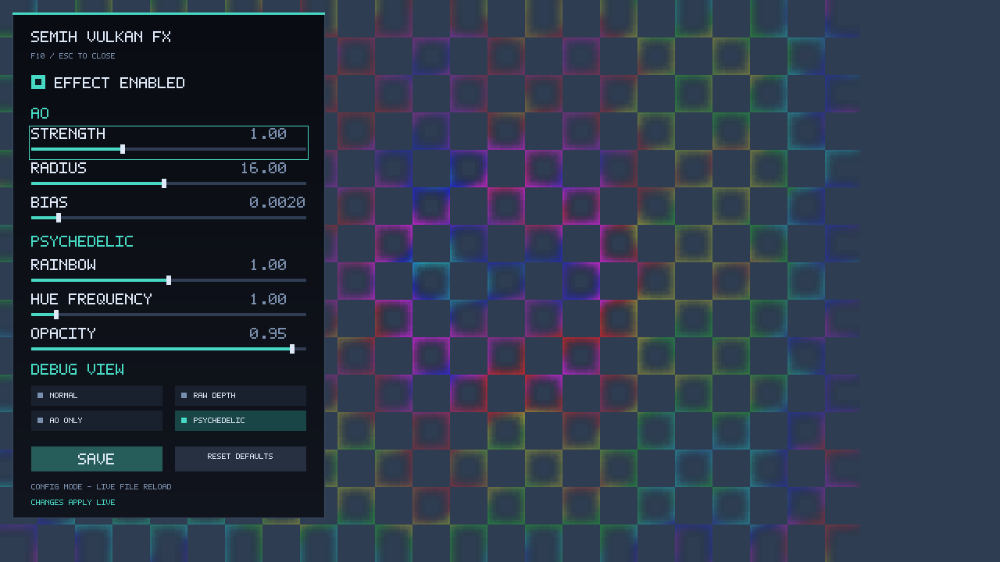

# Eski overlay efektleri, runtime ayarlar ve menü (postfx)

Projenin ilk aşamasından kalan tam ekran efektler ve oyun içi **Vulkan FX** menüsü. Güncel çalışma [Inspector](inspector.md) ve [su](water.md) üzerindedir; bu efektler demo/araştırma özelliği olarak korunur ve Inspector açıkken menü **Advanced** altında durur. Son güncelleme: 21 Eylül 2026.

## Durum

- **Gerçek WoW'da doğrulanan:** rainbow/heartbeat efekti ve legacy AO (eski depth-komşu farkı), menü + Save/Reset, F10, ayar dosyası. Overlay/present protokolü 4.900+ kare stabil ([architecture.md](architecture.md)).
- **Yalnız sentetik GPU/birim testleriyle doğrulanan (WoW kabulü yok):** shader hot reload, scene-color copy, depth diagnostics, linear depth, view-space konum/normal yeniden kurma, hemisphere SSAO + AO blur, sharpen, chromatic aberration, depth fog, contour/outline, GPU timing, genel SSR. Gerçek projection/near/far/FOV ve depth convention **bilinmiyor**; SSAO/SSR açık bir depth convention ve kullanıcı tarafından doğrulanmış projection parametreleri gerektirir (Auto = unknown iken reconstruction atlanır).
- **Desteklenmiyor:** water mask ve suya özel SSR bu menüde yoktur; onlar [water.md](water.md)'de ayrı bir sistemdir. Genel SSR yalnız deneyseldir.
- Yeni özellikler varsayılan kapalıdır; eski rainbow görünümü korunur.

## Efektler

| Efekt | Notlar |
|---|---|
| Rainbow / heartbeat | Ekran merkezinden dışarı yayılan, iki vuruş + duraklama animasyonu yalnız mevcut AO maskesi üzerinde görünür. Tempo FPS'ten bağımsız, geniş ekranda halkalar daireseldir. `DEPTH_PROBE_HEARTBEAT=0` eski sabit görünüm; `DEPTH_PROBE_HEARTBEAT_BPM` (72, 20–240), `DEPTH_PROBE_HEARTBEAT_STRENGTH` (1, 0–1) süreçte bir kez okunur, ilk çizimde `[OVERLAY-HEARTBEAT]` loglanır |
| Legacy AO | 24 komşu depth örneği (view-space SSAO değil); rainbow ile birlikte açılırsa siyah AO rainbow'a eklenir |
| SSAO / AO blur | Hemisphere; explicit convention + projection gerekir |
| Sharpen, chromatic aberration, depth fog, contours, outline | scene-color kopyası (`DEPTH_PROBE_SCENE_COLOR=1`) ve/veya linear depth gerektirenler menüden açılır |
| SSR (genel) | Deneysel, ekran uzayı; ayarlar `ssr_*` |
| Debug görünümleri | `debug_mode`: 0 normal siyah AO, 1 raw depth, 2 yalnız AO, 3 rainbow, 4 scene color, 5 depth gradyanı, 6 linear depth vb. |
| Shader hot reload | `DEPTH_PROBE_SHADER_HOT_RELOAD=1`: 500 ms SPIR-V stat kontrolü, başarısız reload eski pipeline'ı korur, en çok 8 retired generation; dışarıdan `./tools/build-shaders.sh` |
| GPU timing | `DEPTH_PROBE_GPU_TIMING=1`: timestamp sorguları, menüde toplam overlay süresi |
| Depth diagnostics | `DEPTH_PROBE_DEPTH_DIAGNOSTICS=1`: sınırlı record-time viewport/depth-clear/pipeline kayıtları |

Scene-color kopyası kare başına bir tam çözünürlük copy ve orijinal swapchain usage'ında TRANSFER_SRC gerektirir; başarısızsa legacy görünüm sürer. Final kopya oyun HUD'sini de içerir. Linear depth: `near_plane ≥ 0.0001`, `far_plane > near`, sonlu simetrik perspective veya ortografik (`projection_mode`), viewport depth aralığı [0,1]; infinite-far, asimetrik/oblik/jitter'lı projection desteklenmez.

## Ayar dosyası

`$XDG_CONFIG_HOME/vulkan-depth-probe/settings.ini`, yoksa `~/.config/vulkan-depth-probe/settings.ini` (su ayarları aynı dizinde `water.ini`'dedir). Dosya yoksa varsayılanlar; geçersiz/NaN değer alanın varsayılanına döner, geçerli sayılar aralığa sıkıştırılır, bilinmeyen anahtarlar yok sayılır, 64 KiB üzeri dosya varsayılana döner, ondalık ayırıcı noktadır. Save geçici dosya + fsync + rename ile yazar; *Reset Defaults* yalnız çalışma anını sıfırlar (kalıcı olması için Save). Input backend yoksa canlı reload vardır (en çok saniyede bir metadata kontrolü; dosyayı düzenleyip kaydetmek ≈ 1 sn'de etki eder). Log: `[SETTINGS-LOADED] path=…`.

Ana ayarlar (anahtar: aralık; varsayılan kaynağı `src/overlay_settings.cpp`): `ao_strength` 0–3 (1), `ao_radius` 1–32 px (16), `ao_bias` 0–0.02 (0.002), `rainbow_strength` 0–2 (1), `hue_frequency` 0.1–10 (1), `opacity` 0–1 (0.95), `effect_enabled` 0/1 (1; kapalıyken efekt saydam, menü çalışır), `debug_mode` 0–14 (3). Projection: `depth_convention` 0 auto/1 normal/2 reversed, `projection_mode` 0/1/2, `near_plane`, `far_plane`, `vertical_fov`, `ortho_height`. Efektler: `ssao_enabled/strength/radius/bias/samples`, `ao_blur`, `rainbow_enabled`, `ao_legacy_enabled`, `sharpen_enabled/strength`, `chromatic_enabled/amount`, `fog_enabled/start/end/density/red/green/blue`, `contours_enabled`, `contour_frequency/intensity`, `outline_enabled`, `edge_strength/width`, `ssr_enabled/steps/step_size/thickness/max_distance/fade`, `reflection_strength`, `gpu_timing_enabled`, `draw_probe_capture`.

Slider/checkbox/butonlar pipeline, descriptor veya command buffer yeniden oluşturmaz: tüm değerler mapped UBO'dadır; heartbeat dahil. UBO arayüzü değişince (ör. binding 1 UBO) layer ve SPIR-V dosyaları birlikte güncellenmeli ve oyun yeniden başlatılmalıdır.

## Menü ve input

Menü sabit küçük bir panel olarak mevcut Vulkan renderer'a iki shader ve bir pipeline eklenerek çizilir (ImGui yok; font shader içinde sabit). Kapalı menü sıfır vertex üretir. F10 menüyü açar/kapatır (Inspector kapalıyken eski FX menüsü, açıkken Inspector ana sayfası; Advanced eski sayfalara götürür: NEXT ile projection, SSAO, renk efektleri, SSR, diagnostics). Tab/Shift+Tab veya yukarı/aşağı kontrol seçer, sol/sağ slider'ı aralığın %1'i kadar değiştirir, Enter uygular; fare ile slider/checkbox/radio/butonlar çalışır.

Input `overlay_input.cpp`'deki XCB worker'ıyla sağlanır (`libxcb.so.1` dinamik yüklenir, yoksa yalnız config fallback'i; yalnız yerel `DISPLAY`): odaklı X penceresinde `_NET_WM_PID == getpid()` aranır, ≈16 ms'de bir keymap sorgulanır, F10 yükselen kenarda toggle olur. Menü açıkken önce basılı tuş/düğmelerin bırakılması beklenir, sonra doğrulanan pencerede ASYNC klavye ve pointer grab'i bağımsız denenir; alınamayan cihazın girişi oyuna da gider, footer `INPUT SHARED WITH GAME` yazar. Fare grab alınamasa da polled konumla çalışır (≈16 ms'den kısa basışlar kaçabilir); `DEPTH_PROBE_UI_SHARED_POINTER=0` ortak fare fallback'ini kapatır, `DEPTH_PROBE_UI_INPUT=0` XCB backend'ini kapatır. Native Wayland kısayolu, portal veya SDL event interposition yoktur; F10 çalışmazsa `[UI-HOTKEY-UNAVAILABLE]` / `[UI-INPUT]` satırlarına bakın. `DEPTH_PROBE_MENU_VISIBLE=1` menüyü başlangıçta açar.

Aynı pasif keymap yoklamasından **F9** (Camera Telemetry HUD aç/kapa), **Ctrl+F9** (kayıt başlat/durdur) ve **Ctrl+1..9** (işaretleyici) de okunur - grab GEREKTİRMEZ, F10 kapalıyken de çalışır, oyun girişini hiç etkilemez (bkz. [inspector.md](inspector.md#camera-telemetry-hud-round-4-2026-09-22---f10dan-bağımsız-girişe-müdahale-etmez)).

## Efekt paketi (`effects/rainbow-wow/`)

Önceki sürümün rainbow efektinin bağımsız arşividir (uyumlu layer, shader'lar, kaynak yedeği, `run.sh`); yeni scene-depth seçicisini içermez. Ana projeyi değiştirmeden eski görünümü çalıştırmak için `effects/rainbow-wow/run.sh %command%`. `tests/runtime_vulkan_smoke.cpp` bu paketin `shaders/depth.frag.spv` dosyasını piksel karşılaştırma kaynağı olarak okur; **silinmemelidir**.
